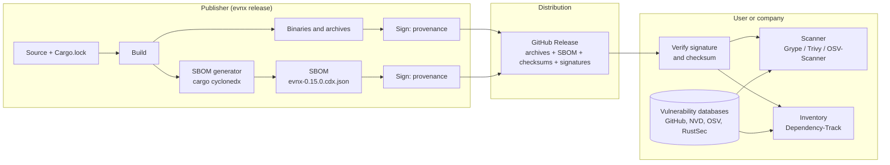
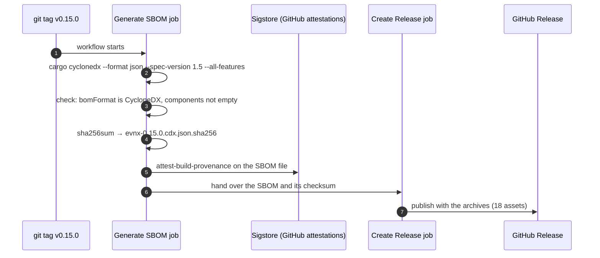

# SBOM: What It Is, Why It Matters, and How evnx Ships One

Every evnx release since 0.14.0 carries a file most people never open:
`evnx-<version>.cdx.json`. It is the software bill of materials, the SBOM. This post
explains what that file is, why companies increasingly ask for one, how it travels through
the software supply chain, how evnx builds and signs it, and how you can check it yourself,
with or without the GitHub CLI.

At the end is the real result: the evnx 0.15.0 SBOM run through Grype, Trivy and
OSV-Scanner.

## What is an SBOM?

An SBOM is a machine-readable list of every component inside a piece of software. For a
Rust program like evnx, that means every crate compiled into the binary, each with:

- its name and exact version (`serde 1.0.228`, `rustls 0.23.x`, …);
- a package URL (purl) such as `pkg:cargo/serde@1.0.228`, which tools use to look it up;
- its licence;
- a hash, so the entry can be tied to one exact release of that crate;
- how the components depend on each other.

The closest everyday comparison is the ingredients label on food. You do not need it to eat
the food. You need it the moment someone asks "does this contain peanuts?", and without it
the only answer is "we would have to check".

There are two common formats. **CycloneDX**, from OWASP, focuses on security and supply
chain use. **SPDX**, from the Linux Foundation, started in licence compliance. Both are
JSON (or XML) documents that tools can read. evnx publishes CycloneDX 1.5.

## Why, how and what: the questions an SBOM answers

**Why have one?** Because modern software is mostly other people's code. evnx itself is
about 100,000 lines of Rust, and its 0.15.0 SBOM still lists 253 packages. When a
vulnerability is announced in one of them, every user of every program that contains it
asks the same question: *am I affected?* An SBOM turns that question from an investigation
into a lookup.

**Who asks for it?**

- **Security teams**, to match new advisories against the software they run.
- **Compliance and procurement.** Many companies, and US federal buyers since Executive
  Order 14028 (2021), now expect suppliers to provide an SBOM before a tool is approved.
- **Legal and licence review**, because every dependency's licence is listed.
- **The maintainers themselves**, to see what they actually ship.

**What does it not do?** An SBOM is an inventory, not a verdict. It does not say the
software is secure. It says what is inside, so that someone, or some tool, can decide. Its
value depends on two things: that it is **accurate** (it describes what was really built)
and that it is **authentic** (it really came from the publisher). The second point is why
evnx signs it.

## How an SBOM works in the supply chain

The supply chain is the path from source code to the program running on your machine:
source, dependencies, build, packaging, distribution, installation. An SBOM is produced at
build time and travels alongside the software along that path.



The important steps:

1. **Produce.** The publisher generates the SBOM from the same dependency resolution the
   build uses, so it lists what was compiled, not what the project once declared.
2. **Sign.** The publisher signs the SBOM, so a consumer can tell it was not swapped or
   edited on the way.
3. **Distribute.** The SBOM is published next to the software, on the same release.
4. **Verify.** The consumer checks the signature and the checksum before trusting it.
5. **Scan, once and continuously.** A scanner matches every component against vulnerability
   databases. Companies go further and load SBOMs into an inventory such as OWASP
   Dependency-Track, which keeps watching: when a new advisory appears next month, it already
   knows which programs, at which versions, contain the affected crate.

That last step is the real payoff. Without SBOMs, a new advisory starts a search across
every team. With them, it is a query.

## How evnx builds, signs and ships its SBOM

The SBOM is part of the release workflow, `.github/workflows/release.yml`, in its own job
named **Generate SBOM**. It runs on every `v*` tag, alongside the platform builds.



The choices behind it:

- **CycloneDX 1.5, JSON**, generated by `cargo cyclonedx`. It reads the resolved
  dependency graph, so versions are the exact ones in `Cargo.lock`.
- **`--all-features`.** The published binaries are built with every feature (`cloud`,
  `migrate`, `backup`, `net`), so the SBOM covers all of them. An SBOM built with default
  features would leave out the cloud HTTP and crypto stack, which is exactly the part a
  security team cares about most.
- **A sanity check before publishing.** The job refuses to continue if the file is not
  CycloneDX or lists no components. An empty SBOM that looks valid is worse than none.
- **A checksum and a signature.** `evnx-0.15.0.cdx.json.sha256` protects against a broken
  download. The signature is a SLSA build-provenance attestation, made through Sigstore by
  the same action that signs the evnx archives. It proves the file was produced by
  `release.yml` in `urwithajit9/evnx`, from the `v0.15.0` tag, on a GitHub-hosted runner.
- **Published with the release.** The SBOM and its checksum are two of the 18 assets on the
  GitHub Release, next to the archives they describe.

<Callout type="info" title="One honest limit">
The attestation proves *where the SBOM came from*. It does not, by itself, bind the SBOM to
one particular archive: the SBOM describes the evnx crate with all features, which is what
every archive is built from. Attaching the SBOM to each archive as a signed predicate (so
`gh attestation verify evnx-<target>.tar.gz --predicate-type https://cyclonedx.org/bom`
works) is planned for 0.16.0.
</Callout>

## How to verify the evnx SBOM

Start in an empty folder.

### 1. Download it

With the GitHub CLI:

```bash
gh release download v0.15.0 -R urwithajit9/evnx -p 'evnx-0.15.0.cdx.json*'
```

Without it, with plain `curl`:

```bash
base=https://github.com/urwithajit9/evnx/releases/download/v0.15.0
curl -fsSLO "$base/evnx-0.15.0.cdx.json"
curl -fsSLO "$base/evnx-0.15.0.cdx.json.sha256"
```

### 2. Check the checksum

```bash
sha256sum -c evnx-0.15.0.cdx.json.sha256      # macOS: shasum -a 256 -c …
```

`OK` means the file arrived intact. It does not yet prove who made it; that is the next step.

### 3. Check the signature

**With gh:**

```bash
gh attestation verify evnx-0.15.0.cdx.json -R urwithajit9/evnx \
  --signer-workflow urwithajit9/evnx/.github/workflows/release.yml \
  --source-ref refs/tags/v0.15.0
```

**Without gh**, the checksum in step 2 is what you can check with no account. The signature
itself is a standard Sigstore bundle, so Sigstore's own tools (`cosign`) can verify it too;
`gh` is simply the shortest way to fetch and check it.

When it passes, it says: this SBOM was made by evnx's release workflow, for that tag, and
has not changed since. On 0.15.0 the output reads:

```text
✓ Verification succeeded!

- Attestation #1
  - Build repo:..... urwithajit9/evnx
  - Build workflow:. .github/workflows/release.yml@refs/tags/v0.15.0
```

### 4. Scan it

All three scanners read CycloneDX directly. Each installs into `~/.local/bin` without sudo.

**Grype** (Anchore):

```bash
curl -sSfL https://raw.githubusercontent.com/anchore/grype/main/install.sh | sh -s -- -b ~/.local/bin
grype sbom:evnx-0.15.0.cdx.json
grype sbom:evnx-0.15.0.cdx.json --fail-on high     # exit 1 on High or Critical
```

**Trivy** (Aqua Security):

```bash
curl -sfL https://raw.githubusercontent.com/aquasecurity/trivy/main/contrib/install.sh | sh -s -- -b ~/.local/bin
trivy sbom evnx-0.15.0.cdx.json
trivy sbom --severity HIGH,CRITICAL --exit-code 1 evnx-0.15.0.cdx.json
```

Trivy prints a warning that a third-party SBOM may be less accurate than one Trivy generates
itself. That is a general notice, not a problem with this file.

**OSV-Scanner** (Google):

```bash
curl -sSfL -o ~/.local/bin/osv-scanner \
  https://github.com/google/osv-scanner/releases/latest/download/osv-scanner_linux_amd64
chmod +x ~/.local/bin/osv-scanner
osv-scanner scan source -L evnx-0.15.0.cdx.json
```

Keep the `.cdx.json` file name: OSV-Scanner recognises an SBOM by it.

**Why use more than one?** They read different databases. Grype and Trivy report
vulnerabilities with a severity (CVE and GitHub advisories). OSV-Scanner also reports
RustSec notices that carry no severity, such as "this crate is no longer maintained". The
union is the fuller picture.

## The 0.15.0 status check

Run on 2026-11-19 against `evnx-0.15.0.cdx.json` (253 packages):

| Check | Result |
|---|---|
| Checksum (`sha256sum -c`) | OK |
| Signature (`gh attestation verify`) | verified: `release.yml` at `refs/tags/v0.15.0`, predicate SLSA provenance v1 |
| Grype | 0 vulnerabilities (0 critical, 0 high, 0 medium, 0 low) |
| Trivy | 0 vulnerabilities (cargo) |
| OSV-Scanner | 4 informational advisories: crates that are no longer maintained (below) |

The four OSV-Scanner entries:

| Advisory | Crate | Reaches evnx through | Type | What we are doing |
|---|---|---|---|---|
| [RUSTSEC-2025-0119](https://osv.dev/RUSTSEC-2025-0119) | `number_prefix` 0.4.0 | `indicatif` 0.17 (progress bars) | unmaintained | upgrade `indicatif` in 0.16.0 |
| [RUSTSEC-2024-0449](https://osv.dev/RUSTSEC-2024-0449) | `unsafe-libyaml` 0.2.11 | `serde_yaml` 0.9 (deprecated by its author) | unmaintained | move to a maintained YAML crate in 0.16.0 |
| [RUSTSEC-2026-0441](https://osv.dev/RUSTSEC-2026-0441) | `pin-utils` 0.1.0 | `hyper`, via the cloud HTTP client | unmaintained | none in evnx; it goes when `hyper` drops it |
| [RUSTSEC-2026-0543](https://osv.dev/RUSTSEC-2026-0543) | `chrono` 0.4.43 | evnx directly | unmaintained | evaluate a replacement for date handling in 0.16.0 |


All four are RustSec "unmaintained" notices: the crate gets no more updates, but no bug in
it is known. None has a severity score or a fixed version, which is why Grype and Trivy,
which report scored vulnerabilities, show zero. We still treat every entry as work: each one
either gets a replacement dependency or a written reason in the project's audit
configuration, so the decision is recorded and re-checked when the lockfile changes.

## Where to find it

- **Every release**: `evnx-<version>.cdx.json` and its `.sha256` on the
  [GitHub Releases page](https://github.com/urwithajit9/evnx/releases).
- **How it is built**: the *Generate SBOM* job in `.github/workflows/release.yml`.
- **How releases are checked**: `docs/RELEASING.md` in the evnx repository.

If your company needs the SBOM in another format (SPDX, for example), open an issue; both
formats come from the same dependency graph.
