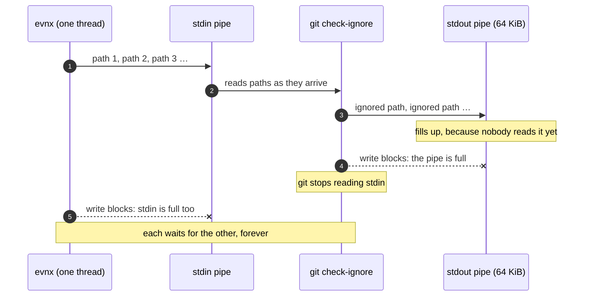
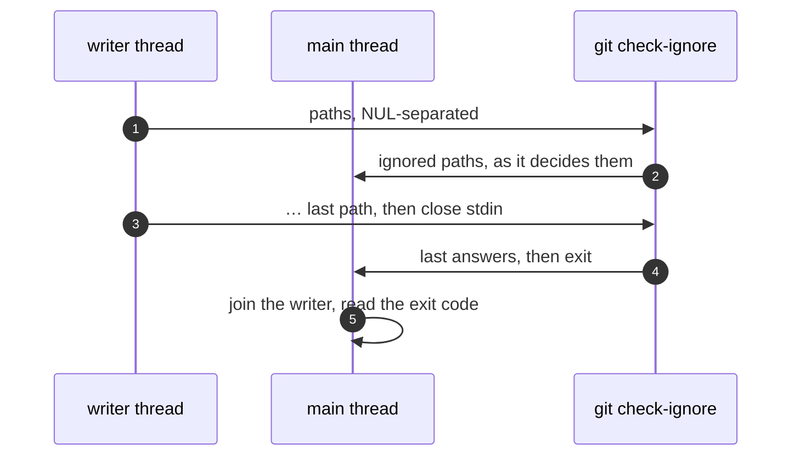

I ran `evnx scan` on a project I had not set up with evnx yet. No `evnx init`, no
`.evnx.toml`, just a real Next.js codebase with a build folder lying around. It printed
the header, as it always does:

```text
  evnx scan  Checking for exposed secrets
```

And then nothing. I waited a minute and nothing changed. I waited two more and it still
showed nothing.

A scanner that hangs is worse than a scanner that crashes. A crash at least tells CI the
step failed. A hang burns the job's whole timeout, and on a laptop it looks exactly like
"this is a big repository, give it time". I almost did.

This post is about what was actually happening, why none of our tests saw it, and the
fix. It also explains a little about pipes, which every tool that shells out to git has
to get right.

## First, it was not slow

The obvious guess is that the walk is big. It was, a bit: the project had 58,407 files,
most of them in `node_modules`, which evnx skips anyway. So I timed it with the v0.12.0
release binary and a two-minute limit:

```text
real    2m0.059s
user    0m0.449s
sys     0m1.087s
```

Two minutes on the clock and **under half a second of CPU**. A scanner working through
thousands of files would use CPU for most of those two minutes. This one was not
working. It was waiting for something.

So I looked at what it was waiting for:

```bash
ps --ppid "$pid" -o pid,stat,etime,args
cat /proc/"$child"/wchan
```

```text
  PID STAT  ELAPSED COMMAND
 1210169 S    00:07 git -C …/evnx-web check-ignore -z --stdin

child wchan: anon_pipe_write
```

There it was. evnx had started `git check-ignore`, and git was asleep **in a write to a
pipe**. And evnx was asleep too.

## Why scan talks to git at all

`evnx scan` asks git one question about every file it walks: is it committed, ignored,
or neither? The answer changes the advice. A secret in a committed file needs a history
rewrite and a rotation. A secret in an ignored file was never pushed, so scan holds that
finding back rather than failing the run over a file that cannot leak.

Asking git once per file would mean thousands of processes, so scan batches it: one
`git ls-files` for what is tracked, and one `git check-ignore -z --stdin` that is fed
every path and answers with the ones that are ignored. Two processes per repository, not
two per file. That batching was a good change in 0.10.14. The way it fed git was the bug.

## The deadlock

This is the code, in `core/gitignore.rs`, as it shipped in v0.12.0:

```rust
let mut child = Command::new("git")
    .args(["check-ignore", "-z", "--stdin"])
    .stdin(Stdio::piped())
    .stdout(Stdio::piped())
    .spawn()
    .ok()?;
{
    let mut stdin = child.stdin.take()?;
    for (_, rel) in members {
        stdin.write_all(rel.as_bytes()).ok()?;
        stdin.write_all(&[0]).ok()?;
    }
}
let answered = child.wait_with_output().ok()?;
```

It reads well: write the question, then read the answer. The problem is that git does
not wait for the whole question before it starts answering. `check-ignore --stdin` reads
a path, decides, and if the path is ignored it writes it to stdout straight away. That
output goes into a pipe, and **a pipe is a fixed-size buffer**: 64 KiB by default on
Linux.

Nobody was reading that pipe yet, because evnx was still in the `for` loop writing paths.
So:



git is blocked because evnx will not read its output. evnx is blocked because git will
not read its input. Neither one can move, so nothing errors, nothing times out, and
nothing prints. That is the hang I saw.

The project that hit it had a `.next/` folder with 5,784 build files in it. All of them
are gitignored, so all of them come back as answers. At around 70 bytes a path, that is
roughly 400 KiB of output, which overflows a 64 KiB pipe several times over.

## Why the tests never saw it

Every test of this function used a handful of files: five in one, one in another. The
whole answer fits in the pipe with room to spare, git writes it, evnx finishes writing,
and `wait_with_output` collects everything. The code is correct right up to the size of
the pipe and wrong past it.

That makes it a bug that only appears on real projects, and specifically on projects
with a lot of *ignored* files. You need build output, a Python `.venv`, coverage reports
or a cache folder to trigger it. A fresh repository never does. Those are the projects
you first run a secret scanner on.

The Rust standard library warns about exactly this, in the docs for `Stdio::piped`:
writing more than a pipe buffer's worth of input to a child without reading its output
at the same time may deadlock. `wait_with_output` does read stdout and stderr while it
waits, but it cannot help if you block on stdin *before* calling it. I knew the rule.
I still wrote the code that breaks it, because with five files it never broke.

## The fix

Write from another thread, so the main thread can read at the same time:

```rust
// Written from another thread while this one reads the answers. Writing
// every path first and reading after deadlocked once the ignored paths
// filled git's stdout pipe (~64 KiB).
let mut input = Vec::new();
for (_, rel) in members {
    input.extend_from_slice(rel.as_bytes());
    input.push(0);
}
let mut stdin = child.stdin.take()?;
let writer = std::thread::spawn(move || stdin.write_all(&input).is_ok());
let answered = child.wait_with_output().ok()?;
if !writer.join().unwrap_or(false) {
    return None;
}
```

Three details matter:

- **The writer owns `stdin` and drops it when it is done.** Dropping the handle closes the
  pipe, which is how git learns there are no more paths. Without that close, git would
  wait for more input forever, and we would have swapped one hang for another.
- **The input is built before the thread starts.** The thread needs owned data, and
  joining a `Vec<u8>` of paths is cheap next to spawning git.
- **A failed write still means "no answer".** If git dies early, the writer hits a broken
  pipe, and the function returns `None`, exactly as before. Scan treats `None` as "git
  could not say", never as "ignored". That rule stops a broken git from hiding a finding.



## Proving it

I wrote the test first and watched it fail. It creates 5,000 files in an ignored folder,
about 350 KiB of answers, five times the pipe. Then it calls `exposures` on a separate
thread and waits at most 60 seconds:

```rust
let (tx, rx) = std::sync::mpsc::channel();
std::thread::spawn(move || tx.send(exposures(&files)).ok());
let views = rx
    .recv_timeout(std::time::Duration::from_secs(60))
    .expect("exposures did not return within 60 s: git check-ignore deadlocked");
```

The timeout is the important part. A test for a hang that itself hangs forever is a CI
job that never reports, which is the same failure we were fixing. On the old code:

```text
exposures did not return within 60 s: git check-ignore deadlocked: Timeout
test result: FAILED.
```

With the fix it passes in well under a second. On the real Next.js project, the scan
that never finished now completes in about 35 seconds, holding back the 1,100 ignored
files it found, and exits 1 for the findings that are actually committed.

## Checking it with the release

I rebuilt the shape of the problem for the v0.13.0 binary: a git repository with a
gitignored `.next/static/` folder holding 6,000 files, each with a (fake) live Stripe key
in it, so that every file produces a finding for git to be asked about. On v0.12.0 that
is the setup that hung. On v0.13.0:

```text
$ time evnx scan .

  evnx scan  Checking for exposed secrets

  scanning ./.env, ./.gitignore, ./.next/static/chunk-00000-a1b2c3d4e5f6a7b8c9d0e1f2.js and 5999 other files

  ✓  No secrets in files git would commit

  6002 files scanned
  ·  git ignores ./.next/static/chunk-00000-a1b2c3d4e5f6a7b8c9d0e1f2.js, ./.next/static/chunk-00001-a1b2c3d4e5f6a7b8c9d0e1f2.js, ./.next/static/chunk-00002-a1b2c3d4e5f6a7b8c9d0e1f2.js and 5997 other files — 6000 findings there are not counted, because they are not committed (--include-ignored lists them)
  Docs: https://docs.evnx.dev/cli/commands/scan

real	0m0.183s
```

It exits 0, because nothing in it would be committed. This small synthetic repository
finishes in a fraction of a second. The 35 seconds in the changelog is the real Next.js
project, with 58,407 files to read.

## What I take from it

**A process you pipe both ways is a protocol, not a function call.** The moment you give
a child stdin *and* stdout, you have two buffers that can fill, and the order you service
them in is part of correctness. "Write everything, then read everything" is safe only
while the answer is smaller than the pipe, and nothing tells you when it stops being.

**Test the size, not just the shape.** Every test checked that the answers were *right*.
None checked what happens when there are a lot of them. For anything that streams, one
test with more data than a buffer holds is worth more than five with a few rows.

**A hang needs a timeout in the test.** Otherwise the regression you are guarding against
shows up as a stuck CI job, which is what you were trying to prevent.

**Silence is a symptom.** Scan printed nothing between the header and the result even
when it was working normally, so a hung scan and a slow scan looked the same. That is
a separate improvement I want to make: a progress line on long walks, so "still going"
and "stuck" look different.

The fix ships in v0.13.0 and is listed in the [changelog](/changelog).
If you have run `evnx scan` on a project with a big ignored build folder and given up
waiting, this was why.
