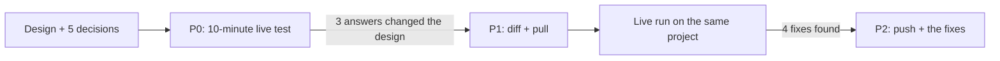
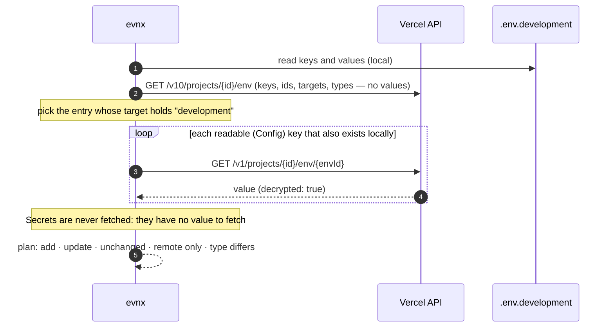
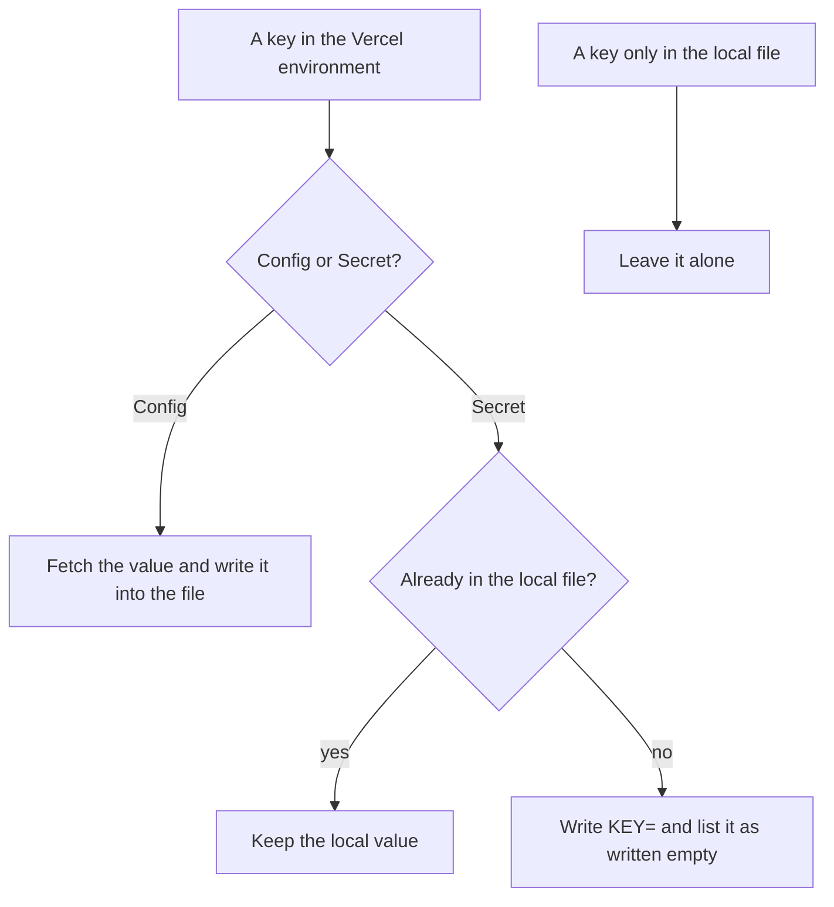

Until now, `evnx migrate --to vercel` did one thing: it printed `vercel env add`
commands for you to run. That's one-way, offline, and good enough for a first
deploy. It's no help on the second day, when someone changed a value in the
Vercel dashboard and your local `.env.development` quietly went stale.

evnx 0.14.0 adds two commands that talk to Vercel directly:

```bash
evnx platform diff --to vercel --env-name development   # what differs, never the values
evnx platform pull --to vercel                          # bring Vercel's readable values down
```

`push` comes in the next phase. This post covers the read-only half: how we
designed it, the live test that changed that design before any code existed,
and the live run of the finished commands.

## Ask the API before trusting the docs

The design went through a written review first: five decisions about naming,
what `pull` does with values it can't read, which type a new variable gets, a
local record of the last sync, and when deletes are allowed. Then, before
building anything, we spent ten minutes with `curl`, a throwaway Vercel project
and a project-scoped token, asking the API what the docs left open.



These are the questions and what Vercel answered:

| Question | Answer from the live API | What it changed |
|---|---|---|
| Can a Secret target Development? | Yes. Vercel reversed its old rule on 2026-08-24 | `convert` and `migrate` now mark secrets sensitive in every environment |
| What does the list return for a Secret? | `value: ""`, `decrypted: false`, with or without `decrypt=true` | The list never yields values |
| What does `upsert=true` do with a new target set? | It **matches by key and replaces the whole target list** | `push` must never upsert |
| Can one key have several entries? | Yes, with separate ids and different targets | A variable is *key + target set*, not just a key |
| How do you read a value now? | `decrypt=true` is deprecated (a warning header says so); `GET /v1/projects/:id/env/:envId` returns it | Read readable values one at a time |
| And a Secret, read that way? | No `value` field at all | "No value" means write-only, never "empty string" |
| A bad token? | `403` with `"invalidToken": true` | Tells "bad token" apart from "no access" |

Two of these would have caused real damage if we had trusted the obvious
reading of the docs.

**Upsert replaces the targets.** Suppose `DATABASE_URL` is one entry shared by
production and preview. A tool that pushes production with
`upsert=true, target: ["production"]` gets back a success, with the same id.
Preview has silently lost the variable. So evnx edits entries by id and
computes target sets itself.

**One key, several entries.** The same key can exist once for
`[development, preview]` and again for `[production]`, each with its own value.
Any sync that treats "key" as the unit will compare the wrong value half the
time. evnx picks the entry whose targets contain the environment you asked for.

## How `diff` reads a project



The result is a plan, and values never appear in it:

```text
Vercel  prj_…  development        local  .env.development
  ~ APP_URL      config  update  (value differs)
  = LOG_LEVEL    config  unchanged
  ~ DB_PASSWORD  secret  update  (value cannot be compared: write-only)
  + LOCAL_ONLY   config  add
  ! REMOTE_ONLY  config  remote only  (not in the local file)
1 add · 2 update · 1 unchanged · 1 remote only · values never shown
```

`diff` exits 1 when anything differs, so a CI job can gate on it. With
`--format json` you get the same plan as data: keys, kinds and actions only.

## What `pull` does with each key

The hard case is a Secret. Vercel will never hand its value back, so `pull`
has to decide what to write. We decided it in the design review, before writing
code:



Everything else follows the rules the rest of evnx already keeps:
- a preview and a confirmation before writing (`--yes` for scripts, `--dry-run`
  to look);
- the file's comments, `export` prefixes, CRLF line endings and order are kept;
- a `.bak` copy and an atomic write;
- a warning if the file is readable by other users.

After a pull, evnx records `.evnx/platform/vercel.json`. It holds only each
entry's key, id, targets, type and `updatedAt`, never a value or a hash of one.
`push` will use it to notice "someone changed this on Vercel since your last
pull" and stop with exit 14, as `evnx cloud push` already does.

The token comes from `VERCEL_TOKEN` or `--token-file`. There is deliberately no
`--token <value>` flag, so the token can't end up in shell history.

## The live run

With phase 1 merged, we ran it against the same scratch project. We put four
development variables on Vercel (two readable, one Secret, one only on Vercel)
plus a separate production entry for `APP_URL`, and a local file that disagreed
in every way we could think of.

| Check | Result |
|---|---|
| Picks the development entry, not the production one, for `APP_URL` | ✅ |
| Readable value compared, then pulled (`APP_URL` updated) | ✅ |
| Local Secret kept (`DB_PASSWORD` unchanged) | ✅ |
| Remote-only key added; local-only key untouched | ✅ |
| Order kept, `.bak` made, permission warning, `.gitignore` offer | ✅ |
| State file: four development entries, no values | ✅ |
| `--env-name production` uses the production `APP_URL` entry | ✅ |
| No value printed anywhere | ✅ |

It also found four things to fix. They go into phase 2:

1. **`diff` could never pass on a project with Secrets.** A Secret present on
   both sides is "cannot compare", and we counted that as a difference. So
   `diff` exited 1 forever, which makes it useless as a CI gate. Now it counts
   as unchanged for the exit code, and `--strict` brings back the old behaviour.
2. **A bad token looked like a permissions problem.** Vercel answers a bad
   token with `403`, so evnx said "this token may not read that" and pointed at
   the team. The response carries `"invalidToken": true`, so evnx can now say
   "invalid or expired" and exit 10, the same code `evnx cloud` uses.
3. **`diff` refused to run without a local file.** It now treats a missing file
   as empty, and everything on Vercel shows as remote-only.
4. **The state file got a hint where the env files get a question.** It will
   now ask before adding `.evnx/platform/` to `.gitignore`, as it already does
   for env files.

## What's next

Phase 2 is `push`: create new keys, edit existing entries by id, split a shared
entry when one environment needs a different value, and check `failed[]` on
every create, because Vercel can answer `201` while rejecting one of the
variables. Deletes will only happen with `--prune`, listed in the plan and
confirmed.

The lesson we'd pass on applies to any API: when its docs leave a question
open, ask the API itself. Ten minutes with `curl` against a throwaway project
found the upsert behaviour, which would otherwise have shipped as a bug that
silently drops variables.
