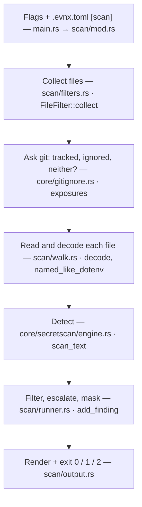
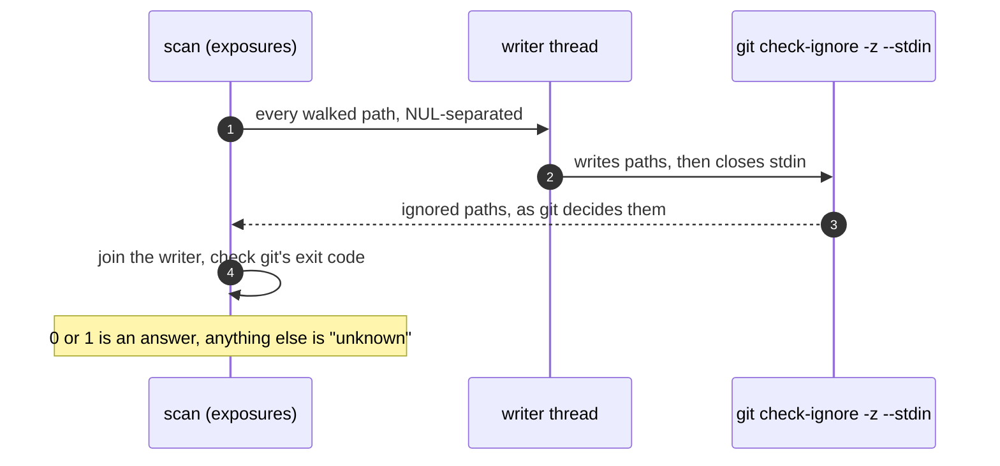
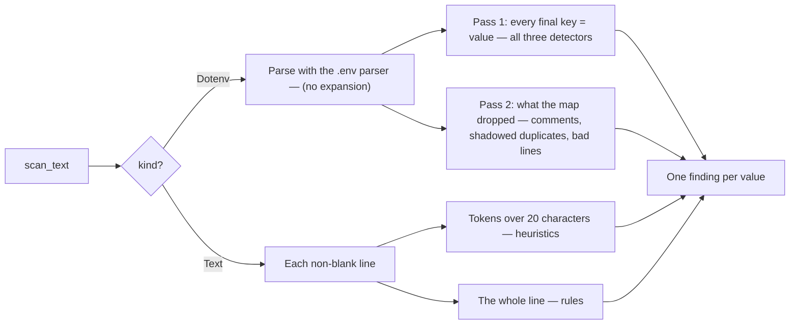

<Callout type="warning" title="Describes evnx v0.13.0, which is being built">
The file layout on this page is the v0.13.0 one: the detection engine moved into
`core/secretscan/engine.rs` and `utils/patterns.rs` is gone. What scan *does* is the
same as v0.12.0, with one fix: v0.12.0 could hang on a project with thousands of
gitignored files (see [Talking to git](#talking-to-git)). This page will be checked
against the release before it is published.
</Callout>

`evnx scan` answers one question: **is it safe to push this?** It walks your files,
finds values that look like live credentials, and exits with a code CI can gate on.

Almost every design decision in it comes from one rule: **a scanner that misses is
worse than no scanner, because it reports clean.** So scan fails loudly wherever it
could otherwise skip quietly: a file it cannot decode, a path that does not exist, a walk
that found nothing to read, a rule that does not compile. Each of those is exit 2,
"no verdict", never exit 0.

## The pipeline



Two halves, deliberately separate:

| Half | Lives in | Knows about |
|---|---|---|
| **The command** | `src/commands/scan/` | files, folders, git, decoding, flags, output formats, exit codes |
| **The engine** | `src/core/secretscan/` | text in, detections out. No files, no git, no output |

The engine is in `core` because more than one command needs it. `sync` asks it which
detector would report a value before writing that value into `.env.example`. And
anything that has text but not a file can call it the same way: a piped diff today, a
staged diff or a parsed YAML file later.

## 1. Settings

`main.rs` loads `.evnx.toml` (walking upward from the current folder) and merges its
`[scan]` table with the flags. The merge rule depends on the setting:

| Setting | Rule |
|---|---|
| `exclude`, `patterns` | **added together**: the flag and the config both apply |
| `ignore_placeholders` | the flag wins in either direction, else the config |
| `severity`, `max_file_size`, `extensions` | the flag wins, else the config, else the default |

Three settings can *weaken* a scan: `severity`, `exclude` and `disable`. The file they
live in is committed, so one commit could narrow scanning for everyone who clones the
repository. Scan prints which of them are in force, and that line survives `-q`.

A `.evnx.toml` that does not parse is exit 2, not 1. For scan, 1 means "secrets found",
and a broken config must not look like a finding.

## 2. Choosing files

`scan/filters.rs`, `FileFilter::collect`:

- **A file you name is always read**, whatever the exclusions, the extension list or the
  size limit say. It is the file you asked about.
- **A folder is walked** in a stable order, without following symlinks.
- The walk always skips `.git`, `node_modules`, `target`, `dist` and `build`, and also
  skips templates (`.env.example` and friends, which exist to hold fake values),
  editor swap files, and evnx's own encrypted backups. A backup is recognised by its
  name *and* its content, so a hand-written plaintext `.env.backup` is still scanned.
- Files over the size limit (1 MiB by default) are listed as skipped, with the reason.
- A path that does not exist fails the whole run, and so does a walk where every
  file was skipped. "0 files scanned, no secrets" with exit 0 would pass every CI
  pipeline that ran it.

## 3. Talking to git

Before reading anything, scan asks git one question about every file: is it **tracked**,
**ignored**, or **neither**? The answer decides two things:

- **What is reported.** A walked file that git ignores and does not track was never
  pushed, so its findings are held back and summarised, rather than failing the run.
  `--include-ignored` reports them anyway. A tracked file is always reported:
  `.gitignore` does not untrack a file that is already committed.
- **What the advice says.** A committed secret needs rotating and a history rewrite. An
  unignored one needs a `.gitignore` entry before the next `git add .`.

`core/gitignore.rs`, `exposures`, asks git twice per repository, not twice per file:
`git ls-files -z` for what is tracked, and `git check-ignore -z --stdin` fed every path.
If git is missing or the folder is not a repository, the answer is "unknown", never
"ignored": a broken git must not hide a finding.



<Callout type="danger" title="Why the writer thread exists">
Until v0.13.0 the paths were written to git first and read back after. git answers as
it reads, into a pipe that holds about 64 KiB. On a project with a few thousand ignored
files (a `.next/` build, a `.venv`), that pipe filled, git stopped reading, and scan
waited forever with only its header printed. Writing from a separate thread lets both
sides move at once. The full story is in the blog post
[The scan that never finished](https://www.evnx.dev/blog/the-scan-that-never-finished).
</Callout>

## 4. Reading a file

`scan/walk.rs`:

- **Decoding.** A file is read as bytes and decoded in this order: a UTF-16 byte-order
  mark, a UTF-8 BOM (stripped), BOM-less UTF-16 (accepted only if the result looks like
  text), then strict UTF-8. A Windows editor's UTF-16 `.env` once scanned "clean" over a
  live AWS key, which is why this exists.
- **Undecodable files.** A walked image or archive is skipped, said in one line. A file
  you named, or one that should be text (`.env`, `.yml`), that cannot be decoded **fails
  the run**: it is listed as unreadable rather than treated as clean.
- **Which detectors a file gets** is decided by its name alone. `.env`, `.env.*` and
  `*.env` (Compose's `env_file:`) are read **as a `.env`**, unless the name says they
  are structured (`.env.json`, `.env.yaml`). Everything else is read **as text**. Piped
  input (`evnx scan -`) is read as a `.env` when it parses as one.

`-v` and the JSON output list how each file was read, so a result can always be traced
back to which detectors ran.

## 5. The detection engine

`core/secretscan/engine.rs` has one entry point:

```rust
pub fn scan_text(text: &str, ctx: &Context) -> Vec<Found>

pub struct Context<'a> {
    pub path: &'a str,                  // used in locations: "./.env:4 (API_KEY)"
    pub kind: Kind,                     // Dotenv or Text
    pub document: Option<&'a Document>, // an already-parsed .env, if the caller has one
    pub registry: &'a DetectorRegistry, // rules, disabled set, the [vars] contract
}

pub struct Found { pub line: usize, pub variable: Option<String>, pub detection: Detection }
```

Text goes in, and detections come out with their line and, for a `.env`, their variable.
The engine never opens a file, never asks git and never prints.

### The detectors

`core/secretscan/detector.rs` registers three detectors, in this order:

| Detector | Reads | What it reports |
|---|---|---|
| **Rules** | the value | provider formats from `core/secretscan/rules.rs` plus your `[[scan.patterns]]`: AWS, Stripe, GitHub, OpenAI, Anthropic, private keys, URLs with a password |
| **Heuristics** | the value | from `core/secretscan/heuristic.rs`: an AWS secret key (40 characters, only when the name says AWS, high entropy) and a generic high-entropy fallback (32+ characters) |
| **Config key** | the name only | a secret-sounding name (`*_TOKEN`, `*_SECRET`, `PASSWORD`) with a value that is not a placeholder, a path, a number or a plain address |

All the rules compile into one `RegexSet`, so most lines are rejected in a single pass,
and the Rust regex engine runs in linear time: no rule, including one you write, can make
a scan hang on a pathological line.

### Two ways to read text



- **A `.env`** goes through the real parser, with expansion off, so a multiline PEM key
  is one value and `$OTHER` is never substituted. The first pass scans the variables a
  program would get. The second scans what that map hides: a commented-out
  `# STRIPE_KEY=sk_live_…`, a real value overwritten by a blank one further down, and a
  line the parser refuses. A secret in any of those was still committed.
- **Any other file** is read line by line: tokens longer than 20 characters go to the
  heuristics, and the whole line goes to the rules (an AWS access key is exactly 20
  characters, so it arrives only that way). Name-based detection does not run on text
  files yet; planned for v0.13.0 is reading names from YAML, JSON and TOML too.

### One value, one finding

More than one detector can describe the same value: `STRIPE_SECRET_KEY=sk_live_…` is a
Stripe key *and* a secret-sounding name. Reporting both would count one key as two
secrets. So detections about the same value are merged, and the winner is:

1. the one that names a provider and links to where you revoke it;
2. then the higher confidence;
3. then the earlier detector.

The merged finding takes the **highest confidence any detector gave**. Two independent
detectors agreeing is stronger evidence than either one, and without this a real AWS
secret key could drop below a `--severity high` gate.

On a text line, values are compared by **containment**, not equality, because a token
often carries the characters around a key (`prefix-sk_live_…-suffix`) while the rule
matched only the key.

## 6. From detection to finding

`scan/runner.rs`, `add_finding`, applies the report's policy, in this order:

1. **`--ignore-placeholders`** drops values like `sk_test_xxxxxxxx` or `your-key-here`.
2. **A public build prefix** (`NEXT_PUBLIC_`, `VITE_`, `REACT_APP_` and others) raises
   confidence. That value is already compiled into every bundle you have shipped. This
   runs *before* the severity filter, so a low-confidence secret behind `NEXT_PUBLIC_`
   is raised rather than discarded.
3. **`--severity`** drops what is below the threshold. It happens here, not at render
   time, so the count, the JSON summary and the exit code describe the same set.
4. **Masking.** A value is shown as its first and last few characters (`sk_l…3f9a`), and
   a value under 8 characters as `<n chars>`. A PEM header is shown whole: it is a
   label, not key material.

Then each file's findings are sorted by line and passed to `scan/output.rs`, which
writes `pretty`, `json`, `sarif` or `github`, and the run exits:

| Exit | Meaning |
|---|---|
| 0 | nothing at or above `--severity` |
| 1 | findings (0 with `--exit-zero`) |
| 2 | no verdict: a bad path, an empty walk, a broken config, a rule that does not compile |

## Where to change what

| You want to… | Start in |
|---|---|
| add or fix a built-in provider format | `core/secretscan/rules.rs` (each rule needs a matching and a near-miss fixture, built from parts at test time) |
| change entropy, placeholder or secret-name logic | `core/secretscan/heuristic.rs` |
| change how detections are merged | `core/secretscan/engine.rs` (`best`, `one_finding_per_value`) |
| scan a new kind of input (a diff, a structured file) | call `engine::scan_text` with your own `Context`; do not add a second reader |
| change which files a walk takes | `scan/filters.rs` |
| change decoding | `scan/walk.rs` |
| change what is reported, or how it is masked | `scan/runner.rs` (`add_finding`) |
| change a format or the advice | `scan/output.rs` |

Planned for v0.13.0, each plugging into the engine rather than beside it:

- **Rules as data** with stable ids, and severity (how bad) separate from confidence (how
  sure). The JSON gains `schema_version: 2`.
- **Names in YAML, JSON and TOML**, so `password:` in `config.yml` is checked by name.
- **Allow markers and a baseline**, for findings you have reviewed and accepted.
- **Staged-only scans and a git hook installer**, scanning exactly what a commit adds.
- **Rule files and packs**: your own rules in the repository, and optional packs pinned by
  hash. The guide "Scan rules: the core, your own, and packs" is published with v0.13.0.

## Checking any of this yourself

```bash
evnx scan -v --format json . | jq '.files, .summary'
```

```bash
git diff | evnx scan -
```

The first shows how every file was read and what was found. The second runs the same
engine over a diff.
