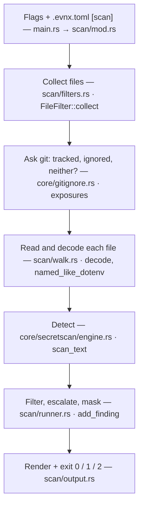
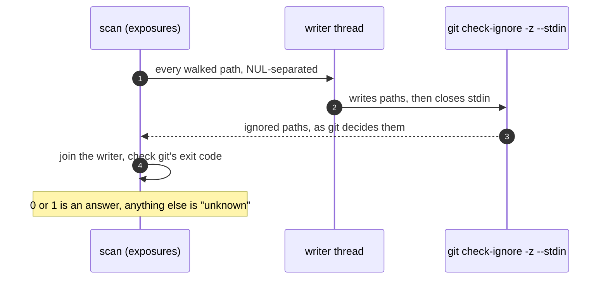
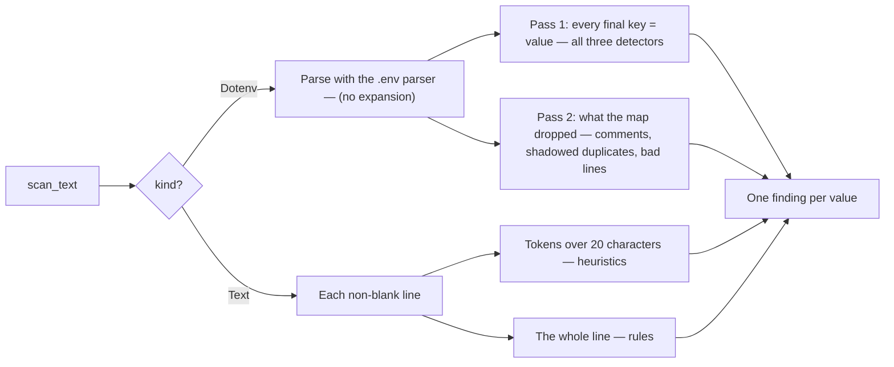

<Callout type="info" title="Describes evnx 0.13.0">
The detection engine lives in `core/secretscan/engine.rs`; `utils/patterns.rs` is gone. New
in 0.13.0: rules are data, severity is separate from confidence, names are read in YAML,
JSON and TOML, allow markers and a baseline, `--staged` and `scan hook`, and rule files and
packs. 0.13.0 also fixes a hang on projects with thousands of gitignored files (see
[Talking to git](#talking-to-git)).
</Callout>

`evnx scan` answers one question: **is it safe to push this?** It walks your files,
finds values that look like live credentials, and exits with a code CI can gate on.

Almost every design decision in it comes from one rule: **a scanner that misses is
worse than no scanner, because it reports clean.** So scan fails loudly wherever it
could otherwise skip quietly: a file it cannot decode, a path that does not exist, a walk
that found nothing to read, a rule that does not compile. Each of those is exit 2,
"no verdict", never exit 0.

## The pipeline



Two halves, deliberately separate:

| Half | Lives in | Knows about |
|---|---|---|
| **The command** | `src/commands/scan/` | files, folders, git, decoding, flags, output formats, exit codes |
| **The engine** | `src/core/secretscan/` | text in, detections out. No files, no git, no output |

The engine is in `core` because more than one command needs it. `sync` asks it which
detector would report a value before writing that value into `.env.example`. And
anything that has text but not a file can call it the same way: a piped diff today, a
staged diff or a parsed YAML file later.

## 1. Settings

`main.rs` loads `.evnx.toml` (walking upward from the current folder) and merges its
`[scan]` table with the flags. The merge rule depends on the setting:

| Setting | Rule |
|---|---|
| `exclude`, `patterns` | **added together**: the flag and the config both apply |
| `ignore_placeholders` | the flag wins in either direction, else the config |
| `severity`, `confidence`, `max_file_size`, `extensions` | the flag wins, else the config, else the default |

Four settings can *weaken* a scan: `severity`, `confidence`, `exclude` and `disable`. The file they
live in is committed, so one commit could narrow scanning for everyone who clones the
repository. Scan prints which of them are in force, and that line survives `-q`.

Rule files, the baseline and `rules.lock` are not `[scan]` settings. `.evnx/rules/`,
`.evnx/rules.lock` and `.evnx/baseline.json` are found beside the `.evnx.toml` in force, so a
scan from a subfolder uses the project's.

A `.evnx.toml` that does not parse is exit 2, not 1. For scan, 1 means "secrets found",
and a broken config must not look like a finding.

## 2. Choosing files

`scan/filters.rs`, `FileFilter::collect`:

- **A file you name is always read**, whatever the exclusions, the extension list or the
  size limit say. It is the file you asked about.
- **A folder is walked** in a stable order, without following symlinks.
- The walk always skips `.git`, `node_modules`, `target`, `dist` and `build`, and also
  skips templates (`.env.example` and friends, which exist to hold fake values),
  editor swap files, and evnx's own encrypted backups. **v0.16.0**: it also leaves out
  evnx's own files in `.evnx/` (`is_evnx_own_file`): the rule files in `.evnx/rules/`,
  `rules.lock`, `baseline.json`, `backups.json` and `platform/vercel.json`. A rule pack
  holds example keys, so scanning it reported them. The run says so once; other files under
  `.evnx/` are scanned, and a file named on the command line is read. A backup is recognised by its
  name *and* its content, so a hand-written plaintext `.env.backup` is still scanned.
- Files over the size limit (1 MiB by default) are listed as skipped, with the reason.
- A path that does not exist fails the whole run, and so does a walk where every
  file was skipped. "0 files scanned, no secrets" with exit 0 would pass every CI
  pipeline that ran it.

## 3. Talking to git

Before reading anything, scan asks git one question about every file: is it **tracked**,
**ignored**, or **neither**? The answer decides two things:

- **What is reported.** A walked file that git ignores and does not track was never
  pushed, so its findings are held back and summarised, rather than failing the run.
  `--include-ignored` reports them anyway. A tracked file is always reported:
  `.gitignore` does not untrack a file that is already committed.
- **What the advice says.** A committed secret needs rotating and a history rewrite. An
  unignored one needs a `.gitignore` entry before the next `git add .`.

`core/gitignore.rs`, `exposures`, asks git twice per repository, not twice per file:
`git ls-files -z` for what is tracked, and `git check-ignore -z --stdin` fed every path.
If git is missing or the folder is not a repository, the answer is "unknown", never
"ignored": a broken git must not hide a finding.



<Callout type="danger" title="Why the writer thread exists">
Until v0.13.0 the paths were written to git first and read back after. git answers as
it reads, into a pipe that holds about 64 KiB. On a project with a few thousand ignored
files (a `.next/` build, a `.venv`), that pipe filled, git stopped reading, and scan
waited forever with only its header printed. Writing from a separate thread lets both
sides move at once. The full story is in the blog post
[The scan that never finished](https://www.evnx.dev/blog/the-scan-that-never-finished).
</Callout>

## 4. Reading a file

`scan/walk.rs`:

- **Decoding.** A file is read as bytes and decoded in this order: a UTF-16 byte-order
  mark, a UTF-8 BOM (stripped), BOM-less UTF-16 (accepted only if the result looks like
  text), then strict UTF-8. A Windows editor's UTF-16 `.env` once scanned "clean" over a
  live AWS key, which is why this exists.
- **Undecodable files.** A walked image or archive is skipped, said in one line. A file
  you named, or one that should be text (`.env`, `.yml`), that cannot be decoded **fails
  the run**: it is listed as unreadable rather than treated as clean.
- **Which detectors a file gets** is decided by its name. `.env`, `.env.*` and
  `*.env` (Compose's `env_file:`) are read **as a `.env`**. A `.yml`, `.yaml`, `.json` or
  `.toml` file is read **as structured data** (**v0.13.0+**). Everything else is read **as
  text**. Piped input (`evnx scan -`) is read as a `.env` when it parses as one.
- **Lockfiles** (**v0.16.0**, `walk.rs`, `is_lockfile`): `package-lock.json`,
  `pnpm-lock.yaml`, `yarn.lock`, `bun.lock`, `Cargo.lock`, `poetry.lock`, `uv.lock`,
  `Pipfile.lock`, `composer.lock`, `Gemfile.lock`, `go.sum` and `npm-shrinkwrap.json` get the
  format rules only. The config-key detector and the entropy fallback are off for them, so
  a package called `react-password-toggle-field` is not a secret name. The JSON `files[]`
  entry has the note "lockfile: only key-format rules, no name or entropy checks".
- **YAML** (**v0.16.0**) is read with `yaml-rust2`, pure Rust: YAML 1.2, anchors resolved,
  the merge key `<<` not applied, every `---` document read. A key given twice, a key that is
  a list or a mapping, or a syntax error sends the file to the text scan.
- **A structured file that does not parse** (a Helm template with `{{- if }}`) falls back to
  text, never an error. `-v` says so and the JSON `files[]` entry has `read_as: "text"` with
  a note.

`-v` and the JSON output list how each file was read, so a result can always be traced
back to which detectors ran.

## 5. The detection engine

`core/secretscan/engine.rs` has one entry point:

```rust
pub fn scan_text(text: &str, ctx: &Context) -> Vec<Found>

pub struct Context<'a> {
    pub path: &'a str,                  // used in locations: "./.env:4 (API_KEY)"
    pub kind: Kind,                     // Dotenv or Text
    pub document: Option<&'a Document>, // an already-parsed .env, if the caller has one
    pub registry: &'a DetectorRegistry, // rules, disabled set, the [vars] contract
}

pub struct Found { pub line: usize, pub variable: Option<String>, pub detection: Detection }
```

Text goes in, and detections come out with their line and, for a `.env`, their variable.
The engine never opens a file, never asks git and never prints.

### The detectors

`core/secretscan/detector.rs` registers three detectors, in this order:

| Detector | Reads | What it reports |
|---|---|---|
| **Rules** | the value | the 70 built-in rules (data in `src/assets/rules.toml`, loaded by `core/secretscan/rules.rs`), then `.evnx/rules/*.toml`, personal rules, `--rules` files, and your `[[scan.patterns]]` |
| **Heuristics** | the value | from `core/secretscan/heuristic.rs`: an AWS secret key (40 characters, only when the name says AWS, entropy above 4.3) and a generic high-entropy fallback (base64 or URL-safe values, entropy above 4.3, not npm integrity hashes, not hex) |
| **Config key** | the name only | a secret-sounding name (`*_TOKEN`, `*_SECRET`, `PASSWORD`) with a value that is not a placeholder, a path, a number or a plain address. In YAML, JSON and TOML the name is the key path (`db.password`) |

All the rules compile once into a single set, so most lines are rejected in one pass, and
the Rust regex engine runs in linear time: no rule, including one you write, can make a scan
hang on a pathological line.

**Prefilter.** A rule's `keywords` are matched first, with one Aho-Corasick automaton: the
rule's regex is tried only on text containing one of its keywords. **v0.16.0**: every
built-in rule declares keywords, so one pass over the text decides which rules run at all;
a test fails for a built-in rule with none unless it is listed with a reason. That is what lets a
pack of hundreds of rules stay fast (the 221-rule `gitleaks` pack took 116 s on evnx-web
against 105 s with no pack). A rule with `names` runs only where the variable or key has a
name, and only when the name matches. A rule's `entropy` floor, `secret_group`, `allow` and
`allow_line` are applied after the regex matches.

**Layers.** Core, project, personal and `--rules` rules are merged add-only: a duplicate id
is a load error naming both files. A pack is checked against `.evnx/rules.lock` before it is
loaded, and a mismatch is exit 2. See
[Scan rules](/guides/reference/scan-rules-and-packs).

### Two ways to read text



- **A `.env`** goes through the real parser, with expansion off, so a multiline PEM key
  is one value and `$OTHER` is never substituted. The first pass scans the variables a
  program would get. The second scans what that map hides: a commented-out
  `# STRIPE_KEY=sk_live_…`, a real value overwritten by a blank one further down, and a
  line the parser refuses. A secret in any of those was still committed.
- **A structured file** (**v0.13.0+**) is parsed, and each string leaf is checked with its
  key path, so `password:` in `config.yml` is judged by name (`./config.yml:2 (db.password)`).
  The line rules still run over the text, comments included, and a value both paths find is
  one finding. `${VAR}` references and non-strings are skipped, and a whole sentence or
  script is not judged by entropy.
- **Any other file** is read line by line: tokens longer than 20 characters go to the
  heuristics, and the whole line goes to the rules (an AWS access key is exactly 20
  characters, so it arrives only that way). Name-based detection does not run on plain
  text files.

### Values inside encoded values

**v0.16.0**, `core/secretscan/decode.rs`. On every line, a token of 16 to 4096 characters
that is base64, hex or percent-encoded is decoded **once**. What comes out must be text
(valid UTF-8, no control characters but tab and line breaks); images, hashes, ciphertext and
random base64 decode to binary and are dropped before any rule sees them. The text is then
checked against the **format rules only**: fixed prefixes, private-key headers, connection
strings. Never names or entropy, because decoded random bytes always look random. One file
offers at most 10,000 candidates, so a minified bundle costs a bounded amount. A finding
from a decoded value carries `encoded` (`base64`, `hex` or `url`).

### Stand-ins with a checksum

**v0.16.0**, `core/secretscan/checksum.rs`. A classic GitHub token (`ghp_`, `gho_`, `ghu_`,
`ghr_` and 36 Base62 characters) is 30 random characters and a 6-character checksum of them.
A value whose checksum fails was never issued by GitHub, so `core/classify.rs` treats it as a
stand-in and it is dropped like a placeholder. A value that passes is certainly the real
shape and is reported with high confidence. `ghs_` and other lengths are not judged.

### One value, one finding

More than one detector can describe the same value: `STRIPE_SECRET_KEY=sk_live_…` is a
Stripe key *and* a secret-sounding name. Reporting both would count one key as two
secrets. So detections about the same value are merged, and the winner is:

1. a rule with `names` that matches the variable or key name (`CLERK_SECRET_KEY=sk_live_…`
   is `clerk-secret-key`, not `stripe-live-secret-key`, **v0.13.0+**);
2. the one that names a provider and links to where you revoke it;
3. then the higher confidence;
4. then the earlier detector.

The merged finding takes the **highest confidence any detector gave**, and the severity of the
winning rule. Two independent
detectors agreeing is stronger evidence than either one, and without this a real AWS
secret key could drop below a `--severity high` gate.

On a text line, values are compared by **containment**, not equality, because a token
often carries the characters around a key (`prefix-sk_live_…-suffix`) while the rule
matched only the key.

## 6. From detection to finding

`scan/runner.rs`, `add_finding`, applies the report's policy, in this order:

1. **`--ignore-placeholders`** drops values like `sk_test_xxxxxxxx` or `your-key-here`.
2. **A public build prefix** (`NEXT_PUBLIC_`, `VITE_`, `REACT_APP_` and others) adds a note
   and `public_prefix` to the finding, and keeps a shape-only finding at least `medium`.
   That value is already compiled into every bundle you have shipped. This runs *before* the
   filters, so it cannot be filtered out by the gate it was added for.
3. **`--severity` and `--confidence`** drop what is below either threshold (**v0.13.0+**:
   severity is how bad, confidence is how sure; both must pass). This happens here, not at
   render time, so the count, the JSON summary and the exit code describe the same set.
4. **Allow markers and the baseline.** A finding with a matching `evnx:allow <rule-id>`
   marker on its line or the line above is `allowed`. One whose fingerprint (BLAKE3 of the
   rule id, the file, and the variable name or line text) is in `.evnx/baseline.json` is
   `known`. Both are listed in the JSON's `allowed` and `known` arrays, counted in the
   summary, and left out of `findings`, `summary.total` and the exit code.
5. **Context hints** (**v0.16.0**, `scan/context.rs`). A value on a line that passes it to an
   `Authorization` or `Bearer` header, an HTTP client call or a credentialed connection
   string is shown one confidence level higher; a file under a `test`, `tests`, `mock`,
   `spec` or `fixtures` folder one level lower. Only name, entropy and medium findings are
   adjusted, so a fixed-prefix rule that is high stays high in a test folder. Neither hint
   removes a finding or changes what fails a build: the `--confidence` floor, the counts
   and the exit code all use the level from before the hint. JSON carries `context` and
   `confidence_before_context`.
6. **Masking.** A value is shown as its first and last few characters (`sk_l…3f9a`), and
   a value under 8 characters as `<n chars>`. A PEM header is shown whole: it is a
   label, not key material. The baseline stores no value or preview at all.

Then each file's findings are sorted by line and passed to `scan/output.rs`, which
writes `pretty`, `json`, `sarif` or `github`, and the run exits:

| Exit | Meaning |
|---|---|
| 0 | nothing new at or above `--severity` and `--confidence`; also a run with nothing staged, and `--update-baseline` |
| 1 | findings (0 with `--exit-zero`) |
| 2 | no verdict: a bad path, an empty walk, a broken config, a rule that does not compile, a pack that no longer matches `rules.lock`, `--staged` or `--history` outside a repository |

**v0.16.0**: the next steps depend on what matched and on git. A history rewrite (revoke,
`git filter-repo`, force push) is advised only for a value matched by a format rule with high
confidence, in a file that a commit on some branch or tag holds (or outside a repository).
A weaker committed finding gets "Check <file>", and a file that is staged but in no commit
gets "Unstage <file>".

## Scanning what a commit records

`evnx scan --staged` (**v0.13.0+**) goes through the same engine, with a different reader.
Instead of walking the disk it asks git for the index and reads every staged blob with one
`git cat-file --batch`:

- It scans what the next commit records, not the working tree. A secret staged and then
  edited out on disk is still found; an unstaged one is not.
- Staged files are scanned whatever `.gitignore` says, and findings carry `"git": "staged"`.
- Nothing staged is exit 0. Outside a repository it is exit 2.
- The advice changes: for a file no commit holds, `git restore --staged`, not
  `git filter-repo` (**v0.16.0**: a staged change to a file that is already in a commit
  keeps the history steps).

`evnx scan hook install` adds a managed block to the repository's `pre-commit` hook that
runs `evnx scan --staged`. The block fails the commit on exit 1, on exit 2, and when
`evnx` is not on `PATH`: a scan that did not run must not look like a pass.

## Scanning history

`evnx scan --history [RANGE]` (**v0.16.0**, `scan/history.rs`) reads git, not the disk,
with the same blob reader as `--staged` (`scan/git_blobs.rs`, one `git cat-file --batch`):

- It lists every blob the commits in the range added or changed. A diff is text, and a name
  rule needs the key beside the value, so each blob is scanned **whole**, as GitHub does: by
  blob id, not by commit.
- A blob that many commits carry is read once and attributed to the **oldest** commit that
  has it, as `path@abc1234:LINE`. JSON adds `commit`, `blob`, `commit_time` and
  `"git": "history"`.
- The range comes from the command line or from a hook's stdin, so it is never allowed to
  look like an option.
- A bare `--history` builds on the last clean history scan of this clone
  (`scan/history_state.rs`, `.git/evnx/history.json`): it reads only the commits made since,
  unless the rule set (`rules_digest`), the scan settings or the baseline changed. `--full`
  reads everything.

`evnx scan hook install --pre-push` adds a `pre-push` hook that runs it on what each pushed
ref adds beyond the remote; `EVNX_SCAN_BYPASS="<reason>"` pushes anyway and logs the reason
to `.git/evnx/bypass.log`. See [Scanning git history](/guides/commands/scan#scanning-git-history).

## Where to change what

| You want to… | Start in |
|---|---|
| add or fix a built-in provider format | `src/assets/rules.toml` (each rule needs a provider, a category and fixtures in `tests/fixtures/rules/`; a test fails without them) |
| change how rule files and packs load | `core/secretscan/rules.rs` (layers, caps), `packs.rs` (catalogue, lock, gitleaks import), `patternset.rs` (the compiled set) |
| change entropy, placeholder or secret-name logic | `core/secretscan/heuristic.rs` |
| change how detections are merged | `core/secretscan/engine.rs` (`best`, `one_finding_per_value`) |
| scan a new kind of input (a diff, a structured file) | call `engine::scan_text` with your own `Context`; do not add a second reader |
| change which files a walk takes | `scan/filters.rs` |
| change file decoding (UTF-16, BOMs) | `scan/walk.rs` |
| change how encoded values are decoded | `core/secretscan/decode.rs` |
| change the GitHub token checksum | `core/secretscan/checksum.rs` |
| change the confidence hints | `scan/context.rs` |
| change how history is read | `scan/history.rs`, `scan/history_state.rs`, `scan/git_blobs.rs` |
| change what is reported, or how it is masked | `scan/runner.rs` (`add_finding`) |
| change a format or the advice | `scan/output.rs` |

Everything in the 0.13.0 list plugs into the engine rather than beside it:

- **Rules as data** with stable ids, and severity (how bad) separate from confidence (how
  sure). The JSON was `schema_version: 2` (it is 3 from 0.16.0).
- **Names in YAML, JSON and TOML**, so `password:` in `config.yml` is checked by name.
- **Allow markers and a baseline**, for findings you have reviewed and accepted.
- **Staged-only scans and a git hook installer**.
- **Rule files and packs**: your own rules in the repository, and optional packs pinned by
  hash. See [Scan rules: the core, your own, and packs](/guides/reference/scan-rules-and-packs).

Not in 0.13.0: parallel scanning (0.14.0); scanning git history, decoding encoded values,
the GitHub checksum, context hints and lockfile handling (0.16.0), all described above.

## Checking any of this yourself

```bash
evnx scan -v --format json . | jq '.files, .summary'
```

```bash
git diff | evnx scan -
```

The first shows how every file was read and what was found (`-v` also lists the allowed and known findings). The second runs the same
engine over a diff.
