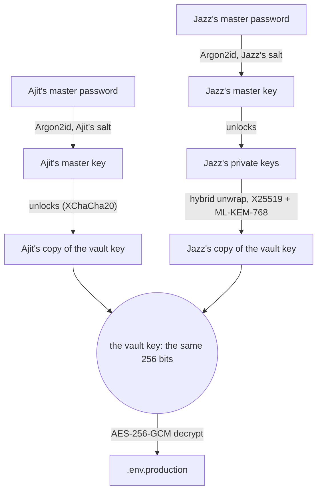
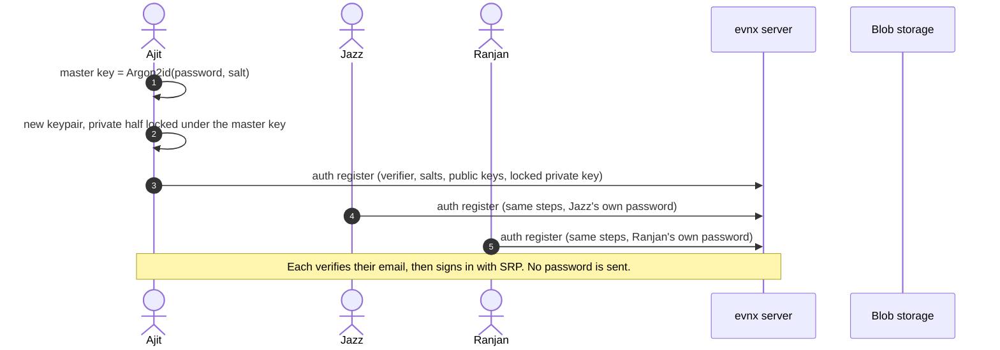
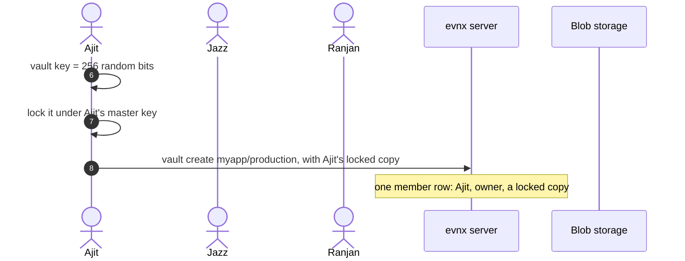
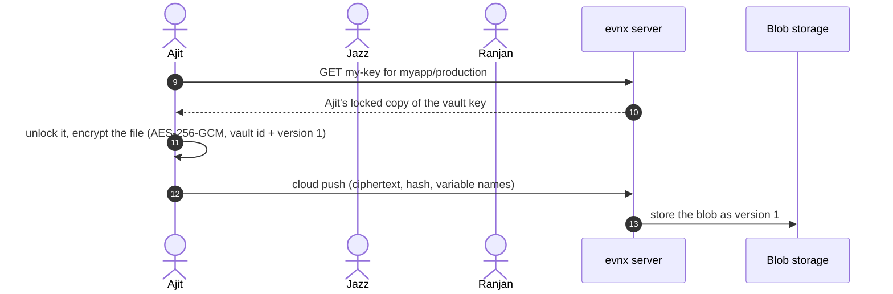
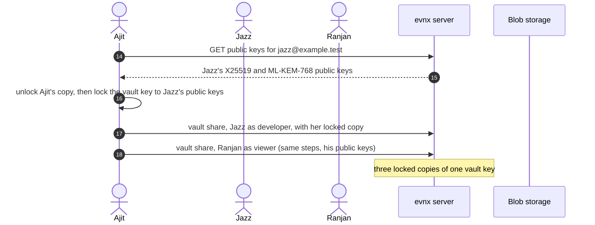
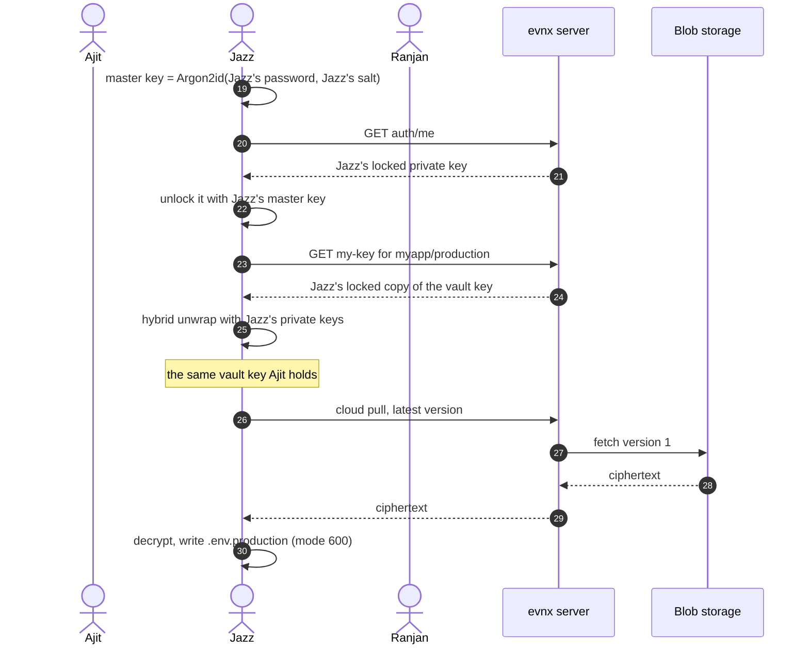
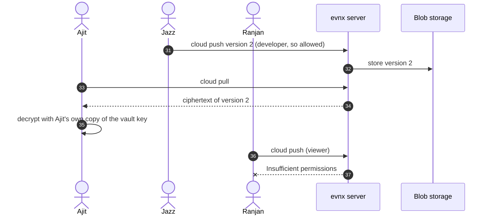
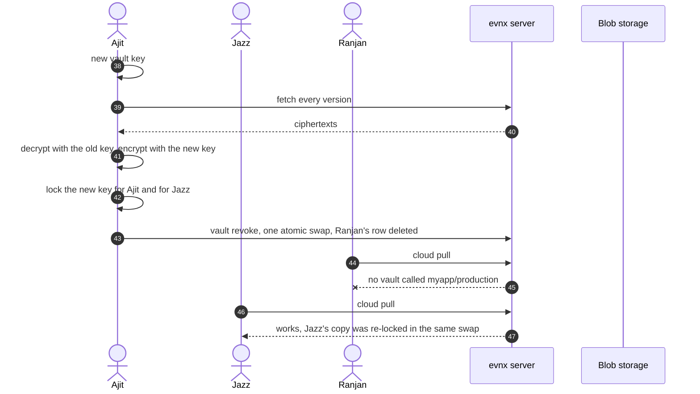
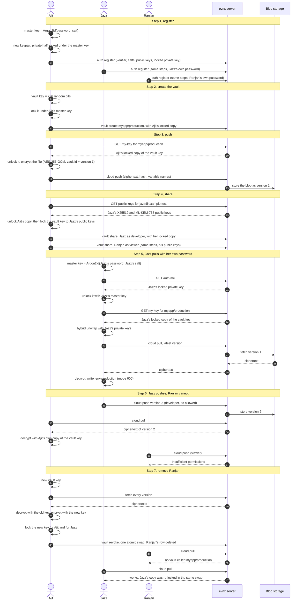
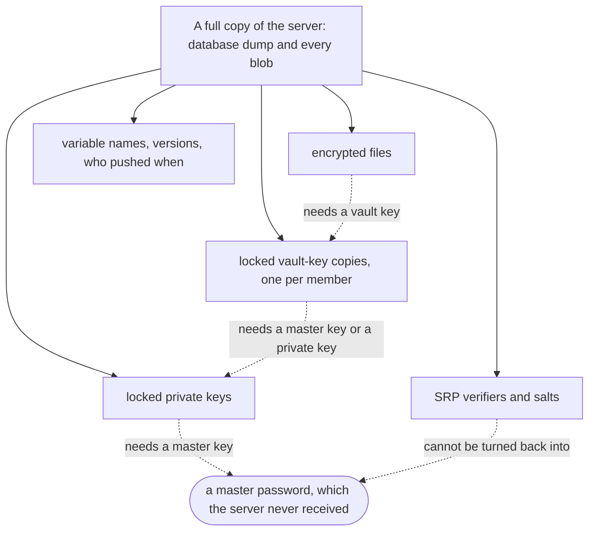

Ajit encrypts a `.env` on his laptop, pushes it to a vault and adds Jazz. Jazz pulls
it and reads it. Ajit never told her his password, and the server never saw the file.
So **which key does Jazz use to decrypt it?**

This page answers that one step at a time. Each step has the command, what happens on
the machine, what is sent to the server, and a diagram. The diagrams are pieces of one
larger diagram: they share the same columns and their arrows are numbered straight
through, so step 3 starts where step 2 stopped. The whole thing is assembled at the end.

<Callout type="tip" title="The short answer">
Each vault has **one random vault key**, and every version of the `.env` is encrypted
with it, never with anyone's personal key.

The server keeps **one locked copy of that vault key per member**. Ajit's copy is
locked with his master key. Jazz's copy is locked to her public keys; Ajit made it
when he shared the vault.

When Jazz pulls, she types **her own** master password. It opens her private key, her
private key opens her copy of the vault key, and the vault key decrypts the file. All
of it happens on her machine.
</Callout>

<Prerequisites>
  <Prerequisite href="/guides/getting-started/cloud-sync-quickstart">Have pushed a vault to evnx cloud once</Prerequisite>
</Prerequisites>

---

## The cast

| Person | Role | Can do |
|---|---|---|
| **Ajit** `ajit@example.test` | owner | creates the vault `myapp/production`, pushes, shares, removes people |
| **Jazz** `jazz@example.test` | developer | pulls, and pushes new versions |
| **Ranjan** `ranjan@example.test` | viewer | pulls and reads; later removed |

The server enforces these roles on every request:

| Role | Pull | Push | Share, change roles, revoke | Delete the vault |
|---|---|---|---|---|
| viewer | yes | no | no | no |
| developer | yes | yes | no | no |
| admin | yes | yes | yes | no |
| owner | yes | yes | yes | yes |

A role decides what the server will **hand you**. It cannot give anyone the ability to
**decrypt**, because the server never holds an unlocked key to give.

<Callout type="info" title="Everything on this page was run">
Every command and every output below comes from the evnx 0.10.14 release binary
against a local evnx-server built from the same commit as `api.evnx.dev`, with three
throw-away accounts. The values in the example file are made up. Where an output
names the server, it shows `https://api.evnx.dev`, the address you will see, in place
of the local test server's.
</Callout>

---

## Four keys, and who holds each

| Key | Where it lives | What it protects |
|---|---|---|
| **Master password** | Only in the person's head. Never sent anywhere. | It is turned into the master key. |
| **Master key** | Made on the device each time, from the password, with Argon2id (64 MiB, 3 passes). Never leaves the device. | Locks the person's private key, and the creator's own copy of a vault key. |
| **Account keypair** | Public half on the server. Private half on the server too, but **locked under the master key**. | Opens vault keys that someone shared with this person. It is two keypairs: X25519 and ML-KEM-768. |
| **Vault key** | Only in locked form on the server, one copy per member. | Encrypts every version of the file with AES-256-GCM. |

Two different paths lead to the same vault key. This picture is the whole answer:



Ajit's copy and Jazz's copy are two different locked boxes with the same key inside.
Ajit opens his with his master key. Jazz opens hers with her private keys, which she
first opens with her master key.

---

## Step 1: everyone registers and signs in

Each person does this once, on their own machine, with their own password:

```bash
evnx auth register --email jazz@example.test
evnx auth login --email jazz@example.test
```

```
  Deriving keys on this machine…
  ✓ account created on https://api.evnx.dev
```

What happens on Jazz's laptop:

1. Her master password goes through Argon2id with a random salt. The result is her
   **master key**.
2. The CLI generates her **account keypair** (X25519 and ML-KEM-768) and locks the
   private half under her master key.
3. It computes an **SRP verifier**: a value that lets the server check her password
   later without ever receiving it.
4. After she clicks the link in the verification email, `evnx auth login` proves the
   password to the server with SRP. Nothing that crosses the wire can be replayed or
   turned back into the password.

| Sent to the server | Never sent |
|---|---|
| SRP verifier, two salts, public keys, the **locked** private key | the password, the master key, the private key in the clear |



---

## Step 2: Ajit creates the vault

```bash
evnx vault create myapp --env production
```

```
  ✓ created myapp/production
```

1. Ajit's machine generates a random 256-bit **vault key**.
2. It locks the vault key under **Ajit's master key** (XChaCha20-Poly1305).
3. The server stores that locked copy as Ajit's member row, with the role `owner`.



---

## Step 3: Ajit pushes the file

```bash
evnx cloud push --vault myapp/production
```

```
  file      ./.env.production (matched the vault environment)
  ✓ pushed ./.env.production to myapp/production as version 1
```

1. Ajit types his master password. The CLI makes his master key, fetches his locked
   copy of the vault key and unlocks it.
2. It reads `.env.production`, the default file for a production vault, and encrypts
   it byte for byte with AES-256-GCM.
3. The vault id and the version number are bound into the encryption. If a server
   tried to serve version 1 as if it were version 2, decryption would fail.

| Sent to the server | Never sent |
|---|---|
| the ciphertext, a BLAKE3 hash, and the variable **names** (so the dashboard can list them) | any value from the file, the vault key, the master key |



---

## Step 4: Ajit shares with Jazz and Ranjan

```bash
evnx vault share myapp/production --with jazz@example.test --role developer -v
evnx vault share myapp/production --with ranjan@example.test --role viewer
```

```
  ✓ shared myapp/production with jazz@example.test as developer
  vault id  7bf37b45-47ac-4cc7-89f8-947adfa28c3b
  key wrap  hybrid X25519 + ML-KEM-768
  ml-kem ct 1452 chars

  They can pull it with:  evnx cloud pull --vault myapp/production
```

This is the step that makes sharing possible, and it happens entirely on Ajit's laptop:

1. The CLI asks the server for **Jazz's public keys**.
2. Ajit types his master password, and his machine unlocks **his** copy of the vault key.
3. It locks the vault key again, this time **to Jazz's public keys**. This lock is a
   *hybrid*: a one-time X25519 key exchange and an ML-KEM-768 encapsulation, mixed
   into one wrapping key. It stays shut as long as either algorithm holds, including
   against a future quantum computer working on a recording made today.
4. The server stores Jazz's locked copy as her member row. Ranjan's share repeats the
   same steps with his public keys.

| Sent to the server | Never sent |
|---|---|
| Jazz's locked copy, the one-time public key, the ML-KEM ciphertext, her role | the unlocked vault key, Ajit's master key or password |



<Callout type="info" title="There is no invite link for a vault">
The vault key has to be locked to a public key that already exists, so the other
person registers first. Sharing with an address that has no account stops before
anything is sent:

```
Error: no evnx account for nobody@example.test.
  They need to register first — the vault key is wrapped to their
  public key, so there has to be one.
```

Organisation invites are a separate feature, and they cannot grant access to a vault.
</Callout>

---

## Step 5: Jazz pulls and decrypts

This is the step the question was about. On Jazz's laptop:

```bash
evnx vault list
evnx cloud pull --vault myapp/production --file .env.production
```

```
  NAME   ENVIRONMENT  ROLE       VERSIONS  UPDATED
  myapp  production   developer         1  2026-10-22
```

```
  file      .env.production (--file)
  ✓ pulled version 1 of myapp/production into .env.production
```

1. Jazz types **her own** master password. With her salt, it becomes her master key.
2. The CLI fetches her locked private key and unlocks it with her master key.
3. It fetches **her** copy of the vault key, the one Ajit made in step 4.
4. Her private keys unwrap it. Out comes **the same vault key** Ajit used in step 3.
5. The CLI downloads the encrypted file, decrypts it, and writes `.env.production`
   readable by her only (mode `600`). It is byte-for-byte the file Ajit pushed.



A wrong password fails at the first lock, before anything is downloaded:

```
Error: could not open your keypair — the master password is wrong.
```

<Callout type="tip" title="Which file a pull writes">
Without `--file`, a first pull into a folder that has no `.env.production` yet writes
`.env` and warns that it came from a production vault:

```
  file      ./.env (default)
  ! writing to a production vault from ./.env — pass --env-name or --file if that is not what you meant
```

Pass `--file .env.production` to keep the same name as on Ajit's machine.
</Callout>

---

## Step 6: Jazz pushes a change

```bash
evnx cloud push --vault myapp/production --file .env.production
```

```
  ✓ pushed .env.production to myapp/production as version 2
```

Jazz unlocks her copy exactly as in step 5 and encrypts version 2 with it. There is
one vault key, so Ajit and Ranjan decrypt her version with their own copies. Ranjan is
a viewer, so his push is refused by the server:

```
Error: Insufficient permissions
```

Jazz can't pass the vault on, either. The CLI shares only from the creator's own copy:

```
Error: myapp/production was shared with you rather than created by you, and re-sharing
is not supported. Ask the owner to share it directly.
```



---

## Step 7: Ajit removes Ranjan

```bash
evnx vault revoke myapp/production --user ranjan@example.test
```

```
  Re-encrypting 2 version(s)…
  Re-wrapping for 2 member(s)…

  ✓ removed ranjan@example.test from myapp/production and rotated the vault key
  2 version(s) re-encrypted, 2 member(s) re-wrapped

  They can no longer read anything pushed from now on.
  They may still hold copies of what they could already read —
  rotate those secrets at their source.
```

Deleting Ranjan's row would not be enough. He may have kept the unlocked vault key,
and it would open every blob, including ones pushed later. So `revoke` **rotates the
key**:

1. Ajit's machine generates a **new** vault key.
2. It downloads every version, decrypts it with the old key and encrypts it with the
   new one.
3. It locks the new key for everyone who stays: Ajit's copy under his master key,
   Jazz's with the hybrid lock to her public keys.
4. One request swaps in all the new blobs and copies at once and deletes Ranjan's row.
   If anything fails, nothing changes.

Ranjan's next pull finds nothing, and Jazz's next pull works unchanged:

```
Error: no vault called "myapp/production". Run `evnx vault list` to see what you have.
```



<Callout type="warning" title="What revoke cannot do">
It cannot reach into Ranjan's laptop. The `.env.production` he pulled before step 7
is still on his disk, and any value he copied is still his. **Rotate those secrets
where they are issued**: the database password, the Stripe key, and so on. evnx can
stop handing a secret out. Only the provider can make the old value worthless.
</Callout>

---

## The whole picture

The seven pieces above, joined. The numbers match the arrows in each step.



---

## What the server actually holds

After step 4, the vault's member rows on the test server look like this. Lengths only;
the bytes themselves are random-looking and useless without a master password.

| Member | Role | Locked vault key | One-time public key | ML-KEM ciphertext |
|---|---|---|---|---|
| ajit@example.test | owner | 96 characters | none | none |
| jazz@example.test | developer | 96 characters | present | 1452 characters |
| ranjan@example.test | viewer | 96 characters | present | 1452 characters |

Ajit's row has no one-time key and no ML-KEM ciphertext, because his copy is locked
symmetrically under his own master key: there is no key exchange to record. Every
shared copy has both. A database rule refuses a row that has one without the other,
so a weakened, X25519-only share can't be stored even by mistake.

The stored versions hold the variable **names** in the clear, and nothing else readable.
On the test server, a search of every stored blob and of a full database dump for any
value from the file found nothing.



Every dotted arrow ends at a master password. That's why a breach of the server,
or anyone with full access to it, gets ciphertext and names but no values.

---

## Questions people ask

**Can the server read the secrets?**
Not passively. A breach, a database dump or a curious operator gets what the diagram
above shows: nothing that opens without a master password.

**Is there any way the server could get in?**
Yes: by lying during a share. In step 4 Ajit's CLI gets Jazz's public keys **from the
server**. A malicious server could hand over its own keys instead, and receive a copy
it can open. evnx doesn't yet let you compare key fingerprints out of band, so the
precise claim is that the server cannot read your secrets **passively**. Sharing is
the one moment that trusts the server to be honest about who is who.

**Does Ajit have to be online when Jazz pulls?**
No. Ajit's part ended when he stored Jazz's locked copy in step 4. From then on Jazz
needs only her own password and the server.

**What if Jazz forgets her master password?**
Then her copy can't be opened, by her, by Ajit, or by the server. Her password is the
only thing that opens her private key, and it is never stored.

**How does a CI pipeline read a vault?**
An [API token](/guides/integrations/ci-cd-cloud-tokens) lets a pipeline reach the
server, but the server holds only locked copies. To decrypt, the pipeline also needs
the master password, kept as a CI secret and piped in:
`echo "$EVNX_PASSWORD" | evnx cloud pull --vault myapp/production --password-stdin`.
On the runner it becomes the master key, exactly as on a laptop.

**Why isn't Ajit's own copy locked with the public-key method too?**
It doesn't need to be, and it is safer this way. A copy locked symmetrically under
the master key involves no key exchange, so there's nothing for a quantum computer to
attack later. Only copies made for someone else need the hybrid lock.

---

## Related guides

- [Sharing a Vault, and Taking It Back](/guides/use-cases/sharing-a-vault-with-a-teammate): the same flow as a hands-on checklist, with what to verify at each step
- [Cloud architecture](/guides/reference/cloud-architecture): the full key hierarchy, what crosses the wire, and the associated data
- [Rotating a vault key](/guides/reference/rotating-a-vault-key): `vault rekey`, and what rotation costs
- [Changing your master password](/guides/reference/changing-your-master-password): rotates the key your own copies sit under
- [vault command reference](/guides/commands/vault): every subcommand and flag
