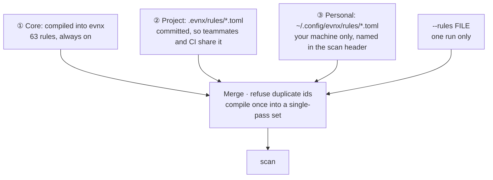
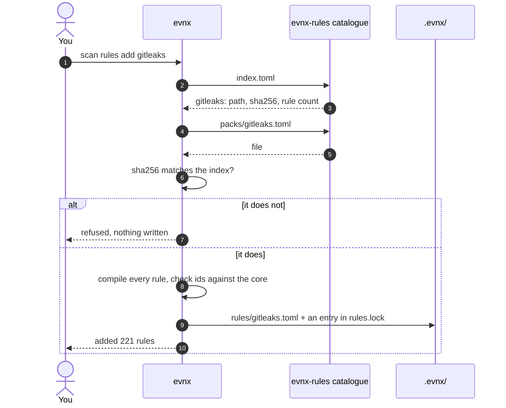

`evnx scan` finds values that look like real credentials. **v0.13.0+** builds its rules from
three layers, so a team can share more rules than a few `[[scan.patterns]]`, reuse rules
other projects have written, and say how bad a finding is separately from how sure evnx is
about it. Everything here is from evnx 0.13.0.

`[[scan.patterns]]` and `--pattern` keep working, and `[scan] disable` still switches a
built-in rule off (evnx announces it on every run).

---

## The layers

Every scan builds one rule set. Each layer can only **add** rules; none can remove or
redefine a rule from a layer below it.



| Layer | Where | Who gets it | Typical use |
|---|---|---|---|
| ① Core | inside the binary | everyone | provider formats evnx vouches for, each with tests |
| ② Project | `.evnx/rules/*.toml` | everyone who clones the repository, and CI | a pack the team chose; your company's internal token formats |
| ③ Personal | `~/.config/evnx/rules/*.toml`, or `$EVNX_CONFIG_DIR/rules` | you alone | trying a rule out; your own side projects |
| one run | `--rules <file>` (repeatable) | that run | testing a file before committing it |

Details that matter:

- **The core is small on purpose.** A rule is in the core only when the provider documents a
  fixed prefix, or a fixed length and character set. Each has examples that must match and
  near misses that must not. Everything wider is opt-in, as a pack.
- **A rule id that is already taken is an error**, naming both files. A rule file cannot
  override a core rule; that would let a downloaded file weaken the scan.
- **Personal rules are always announced.** A scan that uses them says so, so a finding you
  see and CI does not has a visible reason:

  ```text
    + 1 personal rule(s) from /tmp/cfg/rules
  ```
- `.evnx/rules` and `.evnx/baseline.json` are found beside the `.evnx.toml` in force, so a
  scan from a subfolder uses the project's.
- **Limits:** 2 MiB and 5,000 rules per file. A broken personal folder is a warning; a
  broken project file stops the scan (exit 2).
- A rule file written for evnx is plain TOML data. Nothing in it is code.

`evnx scan -v` prints the counts and the rules in force
(`63 built-in rules, 221 custom patterns`).

---

## The rule file format

One format everywhere: the core's own rules, a pack, and a file you write. The fastest
start is the scaffold:

```text
$ evnx scan rules new acme-internal-token
✓ wrote .evnx/rules/acme-internal-token.toml: set its regex and fixtures, then `evnx scan rules test`
```

(`--personal` writes to your personal folder instead.) A complete rule file:

```toml
# .evnx/rules/acme.toml
version = 1

[[rules]]
id         = "acme-internal-token"            # stable; the id in JSON, SARIF, baselines and markers
name       = "ACME internal API token"
provider   = "Acme"
category   = "saas"
regex      = '\bacme_(live|test)_[A-Za-z0-9]{32}\b'
keywords   = ["acme_live_", "acme_test_"]     # the regex runs only where one appears
entropy    = 3.5                              # minimum randomness of the match
confidence = "high"                           # how sure: high, medium, low
severity   = "high"                           # how bad: critical, high, medium, low
url        = "https://wiki.acme.internal/tokens"
positive   = ["acme_live_Zq8rT5vN2mB7xK4pL9wC3dF6hJ1nM0aB"]
near_miss  = ["acme_prod_Zq8rT5vN2mB7xK4pL9wC3dF6hJ1nM0aB"]
```

| Field | Required | Meaning |
|---|---|---|
| `id` | yes | Lowercase letters, digits and `-`. Stable: baselines and `evnx:allow` markers name it. Never rename one |
| `name` | yes | What the finding is called in output |
| `regex` | yes | Rust regex syntax, matched per line. It runs in linear time, so no pattern can hang a scan |
| `provider` | no | Who issues the credential (`Acme`). Shown by `scan rules list` |
| `category` | no | One of the 12 fixed values below. An unknown value is a load error naming the file, the rule and the allowed list |
| `keywords` | no | The rule is tried only on text holding one of these (case-insensitive). With hundreds of rules this is what keeps a scan fast |
| `names` | no | Regexes matched against the variable or key name (`.env` name, YAML/JSON/TOML key). The rule fires only where the name matches, never on text with no name, and beats an unconstrained rule on the same value. An invalid expression is a load error |
| `entropy` | no | Drop matches whose Shannon entropy is below this |
| `secret_group` | no | Which capture group is the secret. That part is judged by `entropy` and `allow`, reported, and masked. Unset: the whole match |
| `allow` | no | Expressions; a secret any of them matches is not reported |
| `allow_line` | no | Expressions; a line any of them matches reports nothing |
| `confidence` | no | `high`, `medium`, `low`. How sure a match is |
| `severity` | no | `critical`, `high`, `medium`, `low`. How bad if real |
| `url` | no | Where to go and revoke a match |
| `positive` | no | Values the rule must report. Read by `scan rules test`, never by a scan |
| `near_miss` | no | Values it must not report. Same |

**Categories** (a fixed list of 12): `cloud`, `source-ci`, `ai`, `payments`,
`databases-backends`, `auth`, `messaging-email`, `observability`, `infra-secrets`, `saas`,
`keys-certificates`, `generic`. Every built-in has a provider and a category; both are
optional in your own files and packs, and a rule without them is listed last as
"uncategorised".

### Severity and confidence

| | Answers | Values |
|---|---|---|
| **severity** | How bad is it if this is real? | `critical`, `high`, `medium`, `low` |
| **confidence** | How sure is evnx that it is real? | `high`, `medium`, `low` |

A Google Maps browser key is matched with high confidence and has low severity, because it
is meant to be public. The usual CI gate is `--severity high`. A rule you write with no
`severity` is `medium`, so it falls out of that gate: set it. See
[evnx scan](/guides/commands/scan#severity-and-confidence).

### Name-aware rules

Some providers reuse another's prefix: Clerk and UploadThing keys start with Stripe's
`sk_live_`. A rule with `names` separates them by the variable name. The built-in
`clerk-secret-key` and `uploadthing-secret-key` work this way; a rule file can do the same:

```toml
[[rules]]
id         = "acme-deploy-key"
name       = "Acme deploy key"
regex      = '[a-f0-9]{40}'
names      = ['(?i)^ACME_DEPLOY_KEY$']
confidence = "high"
severity   = "high"
positive   = ["0123456789abcdef0123456789abcdef01234567"]
```

`scan rules test` checks a rule's value shape and ignores `names`.

---

## Testing a rule

`scan rules test` runs every rule against its own `positive` and `near_miss` values and
reports every failure, not just the first. With no argument it tests every rule file in
force; give a file to test only that one.

```text
$ evnx scan rules test
✗ acme-internal-token: does not report positive "acme_live_short_but_wrong"

  1 failure(s)
$ echo $?
1
```

```text
$ evnx scan rules test
✓ 1 rule(s), 3 fixture value(s): all pass
```

- A rule with no `provider` or `category` gets a warning, never a failure.
- Rules with no fixtures are summarised in one line: only that they compile was checked.
  Imported packs have no fixtures, so for them `test` proves they load:

  ```text
  ! 426 of 426 rules have no positive or near_miss values; only that they compile was checked
  ✓ 426 rule(s), 0 fixture value(s): all pass
  ```
- **Never put a live credential in a fixture.** Use the provider's documented example, or
  build a value from the format.

---

## Packs

A **pack** is a rule file someone else wrote, converted to evnx's format, and published in
the [evnx-rules](https://github.com/urwithajit9/evnx-rules) catalogue. You add one when you
want it, and it is pinned from then on.

```text
$ evnx scan rules add gitleaks
✓ added gitleaks: 221 rule(s) in .evnx/rules/gitleaks.toml, recorded in .evnx/rules.lock
· Commit .evnx/rules/ and .evnx/rules.lock so the team and CI use it too.
```



### The catalogue

| Pack | From | Licence | Rules |
|---|---|---|---:|
| `gitleaks` | gitleaks' default configuration (v8.30.1) | MIT | 221 |
| `betterleaks` | Betterleaks, the actively maintained fork of gitleaks | MIT | 426 |

<Callout type="warning" title="Add one or the other">
Betterleaks is a superset of the gitleaks pack. With both installed, the same key is
reported once per pack. `gitleaks` is the smaller, stable set; `betterleaks` is broader.
</Callout>

Rule ids in a pack carry the pack name in front (`gitleaks-zendesk-secret-key`), so they
never collide with the core. After adding one, `scan rules list` shows its rules with
source `.evnx/rules/gitleaks.toml`, and ids and severity work in baselines and markers like
any other. Imported rules start at `medium` severity unless the source says otherwise.

Only rule sets that are plain data with a licence that allows redistribution become packs.
TruffleHog's detectors are code under the AGPL, and Semgrep's rules carry a licence that
restricts redistribution, so neither can be one. Each source and licence is listed in the
catalogue's [SOURCES.md](https://github.com/urwithajit9/evnx-rules/blob/main/SOURCES.md).

### `.evnx/rules.lock`

The lock file records exactly what was added. Commit it with `.evnx/rules/`.

```text
# Written by `evnx scan rules add`, `update` and `remove`; commit it with the packs.
# A scan refuses a pack whose sha256 no longer matches.
version = 1

[[packs]]
name = "gitleaks"
kind = "catalogue"
source = "gitleaks"
format = "evnx"
sha256 = "b69ef5d82941d44eca89a4250119a8128ded3fa6042422a89542f2e7969cbf7f"
rules = 221
added = "2026-11-08"
```

**Every scan checks it.** A pack whose bytes no longer match its lock entry, or that is
missing, is refused by name with exit `2`: a scan that cannot trust its rules gives no
verdict rather than a clean one.

```text
$ evnx scan
Error: .evnx/rules/gitleaks.toml changed since it was added; run `evnx scan rules update gitleaks` or remove it (`evnx scan rules remove gitleaks`)

No verdict: evnx did not scan anything. This is not a clean result.
```

A catalogue download must also match the sha256 the catalogue's index lists, or nothing is
written. Hand-written rule files have no lock entry and are not checked.

### Updating and removing

```text
$ evnx scan rules update gitleaks -y
  gitleaks: 221 → 221 rules
    (the file on disk had changed; this restores what was added)
✓ updated gitleaks: 221 rule(s)

$ evnx scan rules remove gitleaks
```

`update [<name>] [-y]` fetches again, shows the old and new rule counts and the ids added
and removed, and asks before replacing each pack (`-y` skips the question). **Nothing
updates on its own.** `remove <name>` deletes a pack and its lock entry. It refuses to
touch a hand-written file ("A hand-written rule file is not a pack; delete it yourself").

### Where downloads go, and what a scan never does

Only `scan rules add` and `scan rules update` touch the network. A scan, including in an
air-gapped CI job, behaves exactly as on your laptop.

- Downloads need the `net` feature, which every prebuilt binary has.
- URLs must be **https**, or plain http to this machine (loopback). Anything else is
  refused:

  ```text
  Error: rule files are downloaded over https only, and http://example.com/x is not
  ```
- `EVNX_RULES_CATALOGUE` points at a mirror of the catalogue's `index.toml`. The default is
  `https://raw.githubusercontent.com/urwithajit9/evnx-rules/main/index.toml`. The same
  https-or-loopback rule applies to the mirror.
- `scan rules add <https URL>` adds a single file from a URL, and `scan rules add <path>`
  a local one. Both are locked with their sha256 like a catalogue pack.

| Never | Because |
|---|---|
| Touch the network during a scan | Only `add` and `update` download |
| Run code from a pack | A pack is TOML data; the regex engine runs in linear time; packs are capped at 2 MiB and 5,000 rules |
| Use a pack that changed | `rules.lock` pins each pack's sha256 |
| Let a pack hide a finding | Packs only add rules. Switching one off stays in `.evnx.toml`, which evnx announces |
| Store a secret in a baseline | Fingerprints, rule ids and paths only |

Use `--personal` with `add` to keep a pack in your personal rules instead of the project,
never committed.

---

## Importing a gitleaks or Betterleaks file

`scan rules add <file> --format gitleaks` converts a gitleaks configuration on import. The
converted copy is what is stored and locked, so a scan only ever reads evnx's own format.

```text
$ evnx scan rules add gl.toml --format gitleaks
  2 gitleaks rule(s) not converted:
    path-only: no regex: it matches file paths only
    lookahead: its regex does not compile in Rust: error: look-around, including look-ahead and look-behind, is not supported
✓ added gl: 1 rule(s) in .evnx/rules/gl.toml, recorded in .evnx/rules.lock
· Commit .evnx/rules/ and .evnx/rules.lock so the team and CI use it too.
```

The rule's id gets the file name in front (`gl-acme-key`), and the pack's header lists
what was skipped. It starts with a "do not edit" notice: a scan refuses the file once it
differs from `rules.lock`; use `scan rules update gl` to convert again.

**What carries over:** `regex`, `keywords`, `entropy`, the secret group (`secretGroup` as
`secret_group`), and allowlists made of regexes and stopwords (as `allow` and `allow_line`).
Go's ASCII `\w`, `\d` and `\s` are rewritten as explicit classes so they mean the same in
Rust. From **Betterleaks** files: `confidence` carries over, `valueGroup` is the secret
group, and the leading `entropy(finding["secret"]) < N` clause of a CEL `filter` becomes the
rule's entropy floor.

**What does not convert, and is never dropped silently:**

| Not converted | What happens |
|---|---|
| A rule with only a `path` and no `regex` | Skipped and listed with the reason |
| A regex Rust cannot compile (look-around, backreferences) | Skipped and listed with the compile error |
| Allowlists tied to paths or commits | The rule is kept; the pack header counts these rules, because they may report more than in gitleaks |
| The rest of a Betterleaks CEL `filter`, and a composite's `components` | Counted in the header as "may report more than upstream" |
| Betterleaks rules marked `skipReport` (parts of a composite) | Skipped and listed |
| Betterleaks `validate` (a live API check of the key) | Not carried over. A scan never touches the network |

The `gitleaks` pack, for example, converted 221 rules and skipped 1 (`pkcs12-file`, which
matches file paths only). evnx has its own PKCS#12 detection, by content. The `betterleaks`
pack converted 426 and skipped 48; 384 of the 426 have an entropy floor. gitleaks has no
severity, so imported rules start at `medium` severity and `medium` confidence unless the
source gives a confidence.

---

## `scan rules` at a glance

| Command | Does |
|---|---|
| `scan rules list [--category <name>] [--json]` | Every active rule with its id, provider, severity, confidence and source, grouped by category. `--json` adds `provider` and `category` (null when unset). An unknown category exits 2 |
| `scan rules new <id> [--personal]` | Scaffold a rule file |
| `scan rules test [<file>]` | Check each rule against its fixtures; exit 1 on any failure |
| `scan rules add <name\|url\|path> [--format evnx\|gitleaks] [--personal]` | Add a pack |
| `scan rules update [<name>] [-y]` | Fetch again, show changes, ask |
| `scan rules remove <name>` | Remove a pack and its lock entry |

On `scan` itself: `--rules <file>` adds a file for one run, `--severity` and `--confidence`
filter, and `--baseline` / `--update-baseline` manage accepted findings.

---

## Accepting a finding

Some findings are real matches you have decided to keep. Two ways:

**On the line.** A comment on the same line, or the line above, accepts one rule there and
nowhere else:

```text
# evnx:allow stripe-live-secret-key — documented dummy, not a real account
```

A marker without a reason works, and is warned about. There is no marker that silences
every rule on a line.

**Across a repository.** `evnx scan --update-baseline` records today's findings in
`.evnx/baseline.json`: a fingerprint, the rule, the file and a date, **never a value or a
preview of one**. Findings in it are reported as `known` and do not fail the run.

Both are covered, with output, in [evnx scan](/guides/commands/scan#allow-markers-one-rule-one-line-one-reason).

---

## See also

- [evnx scan](/guides/commands/scan): flags, output formats, baseline, hook and exit codes
- [How evnx scan works](/guides/reference/how-evnx-scan-works): the engine from the inside
- [The configuration file](/guides/reference/configuration-file): `[scan]` settings,
  `[[scan.patterns]]` and `[scan] disable`
- [evnx-rules](https://github.com/urwithajit9/evnx-rules): the catalogue, its sources and
  how to contribute a pack
