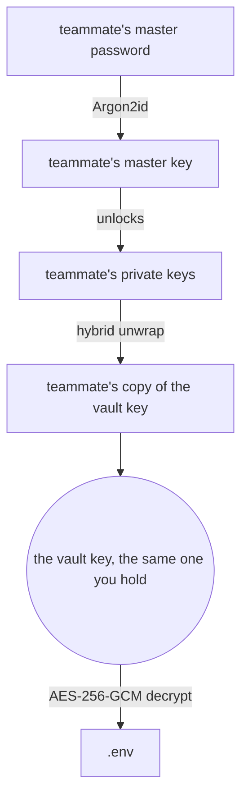

<Callout type="tip" title="Who this is for">
You have a vault in evnx cloud and a second person who needs it. This walks the
whole path with two real accounts — share, pull, revoke — and shows how to check at
each step that what you think happened actually happened.
</Callout>

<Prerequisites>
  <Prerequisite href="/guides/getting-started/cloud-sync-quickstart">Have a vault pushed to evnx cloud</Prerequisite>
  <Prerequisite href="/guides/commands/vault">Know the vault subcommands</Prerequisite>
</Prerequisites>

---

## What you need

Two evnx accounts, both with a verified email address. Throughout, `you@example.com`
is the vault owner and `teammate@example.com` is the person being added.

The second account has to **exist**. A share is wrapped to that account's public
keys on your machine, and registering is what uploads them, so there is nothing to
share with until the other person has run `evnx auth register`. They need a
verified email address before they can pull.

<Callout type="tip" title="How it works, with diagrams">
This page is the checklist. [How Sharing a Vault Works](/guides/reference/how-vault-sharing-works)
explains which key opens a shared vault, one step and one diagram at a time.
</Callout>

---

## 1. Create the vault and push a version

```bash
evnx vault create my-app --env production
evnx cloud push --vault my-app/production
```

```
  ✓ created my-app/production

  Push a .env into it with:  evnx cloud push --vault my-app/production
```

```
  file      ./.env (default)
  ! pushing to a production vault from ./.env — pass --env-name or --file if that is not what you meant
Push ./.env into production vault my-app/production? [y/N] yes
  ✓ pushed ./.env to my-app/production as version 1
```

Pass `--vault`: a folder isn't tied to a vault until you run
`evnx cloud link my-app/production`. Pushing the default `.env` into a production
vault asks first (**v0.10.18+**), because a forgotten `--file` is how development
secrets end up in production. Name the file `.env.production` and the push picks it
up without the warning or the question. In a script with no terminal, the push is
refused unless you add `--yes` or name the file with `--file`.

Your `.env` is encrypted on this machine. The server receives ciphertext and a
BLAKE3 hash, and never holds anything that can open it.

## 2. Share it

```bash
evnx vault share my-app/production --with teammate@example.com --role developer
```

You are asked for your master password. That is not a formality — it is the only
thing that can open your copy of the vault key, and the key has to be **unwrapped
locally** so it can be re-wrapped to the recipient. The server cannot grant access
itself, because it has never held the key in a usable form.

<Callout type="info" title="Roles">
`--role` takes `viewer`, `developer` or `admin`, and defaults to `developer`.

- **viewer** — pull only
- **developer** — pull and push
- **admin** — that, plus sharing, changing roles and revoking

An **admin** can share, because handing out a key is not a developer-level act. Only
the **owner** can make someone an admin, and only the owner can delete the vault.

**v0.10.18+** the CLI lets an admin share too (see step 5). Before, it shared only
from the creator's own copy and refused an admin. A developer or viewer is told which
role sharing needs, before the password prompt:

```
Error: sharing my-app/production needs the admin or owner role; you are a developer on it.
  Ask its owner, or an admin, to share it.
```

The dashboard still shows the Share form to the owner only.
</Callout>

<Callout type="info" title="Who can remove whom">
Removing someone requires **outranking** them, not merely being an admin — so two
admins cannot evict each other, and only the owner resolves a disagreement between
them.

The **owner cannot be removed by anyone, including themselves**: a vault with no
owner has nobody who can delete it or promote a replacement, and there is no
transfer-ownership command yet.

Anyone else can leave on their own with `evnx vault leave` (**v0.10.18+**, see
step 6). `vault revoke` with your own address points there:

```
Error: to leave my-app/production yourself:  evnx vault leave my-app/production
```
</Callout>

<Callout type="info" title="`--with` and `--user` are the same flag">
`share` historically took `--with` while `revoke` and `role` took `--user`, so
whichever you learned first was wrong half the time. Both work on all three from
v0.6.0, and neither is deprecated.
</Callout>

<Callout type="info" title="Sharing again changes nothing">
**v0.10.18+** sharing with someone who is already a member never rewrites their role
or their key. At the same role it says so and exits 0:

```
  teammate@example.com is already a developer on my-app/production — nothing changed.
```

At a different role it is refused, and the `evnx vault role` command that makes the
change is printed instead. Sharing with yourself or with the owner is refused too.
The server refuses all of these as well, so an older CLI cannot do it either.
</Callout>

## 3. Check that it landed

```bash
evnx vault members my-app/production
```

```
  my-app/production — 2 member(s)

  owner      you@example.com (you)
  developer  teammate@example.com
```

Add `-v` to see each member's id and when they were granted access.

## 4. The other person pulls it

On their machine, signed in as `teammate@example.com`:

```bash
evnx vault list
evnx cloud pull --vault my-app/production
```

```
  NAME    ENVIRONMENT  ROLE       VERSIONS  UPDATED
  my-app  production   developer         1  2026-10-22
```

```
  file      ./.env (default)
  ! writing to a production vault from ./.env — pass --env-name or --file if that is not what you meant
  ✓ pulled version 1 of my-app/production into ./.env
```

They are asked for **their own** master password, never yours. Their copy of the
vault key was wrapped to their public keys; their password unwraps their private
key, which unwraps the vault key, which decrypts the blob:



[How Sharing a Vault Works](/guides/reference/how-vault-sharing-works) follows both
people's keys through every step.

<Callout type="info" title="Why the wrap is a hybrid">
A share is wrapped with **X25519 and ML-KEM-768 together**, and the wrapping key is
derived from both shared secrets plus the transcript. It holds if either primitive
survives — which matters because an adversary can record a wrapped key today and
attack it whenever a quantum computer arrives.

There is no X25519-only path. A database constraint makes half a wrap unstorable,
and sharing with an account that has no ML-KEM key on file is refused rather than
downgraded.
</Callout>

## 5. Optional: let them share it on

**v0.10.18+.** Make your teammate an admin, and they can share the vault with a third
person themselves, from their own copy of the key:

```bash
evnx vault role my-app/production --user teammate@example.com --role admin
```

```
  ✓ teammate@example.com is now admin on my-app/production
```

Then, on the teammate's machine:

```bash
evnx vault share my-app/production --with sam@example.com --role developer
```

```
  ✓ shared my-app/production with sam@example.com as developer

  They can pull it with:  evnx cloud pull --vault my-app/production
```

An admin shares as `viewer` or `developer`. Only the owner can make an admin, so an
admin asking for `--role admin` is refused before the password prompt.

## 6. Someone leaves on their own

**v0.10.18+.** A member who no longer needs the vault removes themselves:

```bash
evnx vault leave my-app/production --yes
```

```
  ✓ left my-app/production
  Anything you pulled is still on this machine. The vault key was not rotated: someone who stays can run `evnx vault rekey my-app/production`.
```

Without `--yes` it asks first. Read the second line: leaving deletes their copy of
the key, but **does not rotate it**. If the person leaving held secrets that matter,
run `evnx vault rekey my-app/production` after they go, or use step 7 instead, which
rotates the key as part of removing them.

---

## Taking it back

## 7. Revoke, which rotates the key

```bash
evnx vault revoke my-app/production --user teammate@example.com
```

```
  Re-encrypting 1 version(s)…
  Re-wrapping for 1 member(s)…

  ✓ removed teammate@example.com from my-app/production and rotated the vault key
  1 version(s) re-encrypted, 1 member(s) re-wrapped

  They can no longer read anything pushed from now on.
  They may still hold copies of what they could already read —
  rotate those secrets at their source.
```

Read that output. Removing someone's row would be quick and would achieve nothing:
they may have kept the unwrapped vault key, and it would still open every blob —
**including versions pushed after their removal.** So `revoke` generates a fresh
vault key, re-encrypts every version under it, and re-wraps it for everyone who
stays.

<Callout type="warning" title="It is not instant, and it is not reversible">
The work is proportional to the number of versions in the vault. The server applies
the swap in a single transaction, so interrupting the command cannot leave the vault
half-rotated — but once it completes, the old key is gone.
</Callout>

## 8. Confirm the old access is actually gone

This is the step people skip, and it is the only one that proves anything. On the
removed person's machine:

```bash
evnx vault list
evnx cloud pull --vault my-app/production
```

```
  No vaults yet on https://api.evnx.dev.
  Create one with:  evnx vault create
```

```
Error: no vault called "my-app/production". Run `evnx vault list` to see what you have.
```

The vault is **not in the list**, and a pull fails. Revocation that leaves the
old key working is theatre, and the only way to know which you have is to look.

## 9. Confirm you did not lock yourself out

```bash
evnx cloud pull --vault my-app/production --force
```

```
  file      ./.env (default)
  ! writing to a production vault from ./.env — pass --env-name or --file if that is not what you meant
  ✓ pulled version 1 of my-app/production into ./.env
```

Still works. Your own copy was re-wrapped in the same transaction, so a successful
rotation is one where the removed member is out **and** everyone who stayed is
unaffected. Checking only the first half would not distinguish a correct rotation
from a broken vault.

---

## What revocation does not do

<Callout type="warning" title="Rotate the secrets themselves">
Revoking removes future access. It cannot un-see what the other person could
already read — they may have copied the values to disk, to a clipboard, or to their
own notes at any point while they had access.

If access ended because of a dispute, or because someone left, **rotate the
credentials at their source**: reissue the Stripe key, cycle the database password,
regenerate the JWT secret. evnx can stop distributing a secret. Only the provider
can make the old value worthless.
</Callout>

---

## Doing it in the browser instead

Every step above is available at [app.evnx.dev](https://app.evnx.dev): open a vault,
then **Members**.

- **Share with** — shown to the owner only. An admin who needs to share uses the CLI
  (step 5).
- **Remove** offers *Remove and rotate the key* and *Remove without rotating*. Pick
  the first unless you have a specific reason not to; the second leaves the removed
  member's copy of the key able to open existing blobs.
- The **Activity** trail on the same page shows grants, pushes and revocations.

Your keys never leave the browser tab — the crypto is the same Rust code compiled to
WebAssembly, and the key material lives in a Web Worker, never in `localStorage`.

---

## If something goes wrong

**`no evnx account for teammate@example.com.`**

They haven't registered yet, or the address is spelled differently. The share
stops before anything is sent.

**`teammate@example.com has no post-quantum sharing key yet.`**

Their account was registered with an older evnx and hasn't signed in since. Signing
in uploads the key, and the full message says so:

```
  They need to sign in once with evnx 0.5 or later, or at
  app.evnx.dev, which registers it automatically.
```

Sharing is refused rather than falling back to a weaker wrap, which is why this is
an error and not a warning.

**`you@example.com owns my-app/production, and the owner cannot be removed.`**

By anyone, including the owner, and refused before any work is done. Transfer
ownership first — which is not built yet.

**`sharing my-app/production needs the admin or owner role; you are a developer on it.`**

Only an admin or the owner can share. Ask one of them, or ask the owner to make you
an admin.

**`Insufficient permissions`**

Your role doesn't allow it: a viewer pushing, or an admin removing another admin
(removing someone requires outranking them).

**`there is no terminal to confirm with.`**

A command that asks first (`revoke`, `leave`, `delete`, a production push of `.env`)
ran with no terminal, in a script or CI. Nothing was sent. The message ends with the
same command plus `--yes`; add it if that is what you meant.

**A vault you can see in the dashboard is `not found` from the CLI.**

Check the target. `my-app` and `my-app/production` are different vaults; `vault list`
shows the exact names.

---

## Related guides

- [vault command reference](/guides/commands/vault) — every subcommand and flag
- [Cloud architecture](/guides/reference/cloud-architecture) — where the encryption boundary sits
- [Security model](/guides/reference/concepts-security-model) — what the server can and cannot do
- [Deleting your account](/guides/reference/deleting-your-account) — a vault with other members blocks deletion until they are removed
